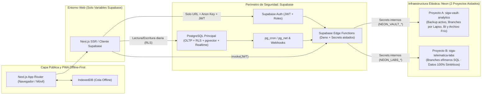
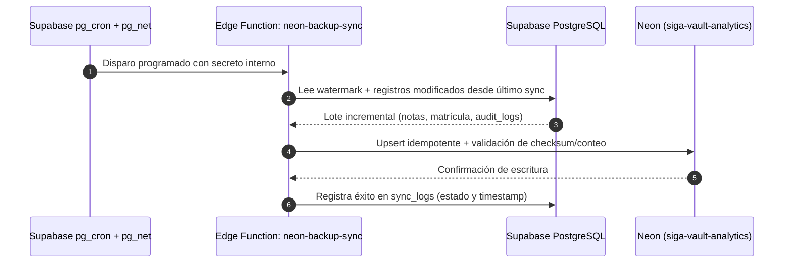
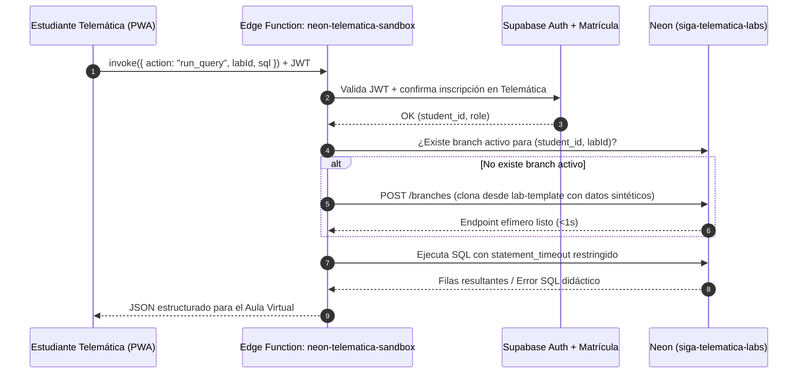

# Arquitectura PostgreSQL (Neon + Supabase) — S.I.G.A.

**Institución:** Escuela Técnica Comercial "Andrés Bello" (Puerto Ordaz, Estado Bolívar · Código DEA `OD01340701`)  
**Alcance del documento:** Especificación arquitectónica de la integración PostgreSQL con **Neon** (base de datos recomendada para producción y *self-hosting*, respaldos inmutables por lapso, analítica BI y laboratorios SQL de **Telemática**) y su evolución desde el diseño híbrido inicial con Supabase Edge Functions.  
**Estado:** En transición planificada hacia **[Neon Serverless Postgres](https://neon.com)** como motor PostgreSQL principal (OLTP). Para desplegar tu propia instancia de S.I.G.A. sobre Neon, consulta primero [`docs/SELF_HOSTING.md`](./SELF_HOSTING.md).

> **Evolución hacia Neon como Base de Datos Principal:**  
> Originalmente S.I.G.A. se diseñó con Supabase como motor OLTP y Neon como bóveda analítica/labs vía Edge Functions (documentado abajo como arquitectura fase 1). Gracias al soporte de **Neon Launch** (*Autoscaling*, *Protected Branches*, *Longer PITR* y PostgreSQL 17 con `pgvector` y RLS), el proyecto está migrando su base de datos relacional principal hacia **Neon**, convirtiendo a **[Neon](https://neon.com)** en la **base de datos recomendada oficial para desarrolladores e instituciones que autohospeden S.I.G.A.** (ver [`docs/SELF_HOSTING.md`](./SELF_HOSTING.md)), manteniendo las credenciales de conexión estrictamente en el servidor (`DATABASE_URL`, nunca `NEXT_PUBLIC_`).

---

## 1. Principio Rector: Una Sola Credencial en Next.js, Todo el Control en Supabase

Para reducir al mínimo la superficie de ataque, simplificar el despliegue y evitar fugas accidentales de credenciales en el repositorio o en el entorno de ejecución web:

1. **Next.js únicamente conoce a Supabase:**  
   Las únicas variables de entorno alojadas en la aplicación Next.js (`src/`, Vercel o Cloudflare Pages) son las de conexión pública y autenticación de **Supabase** (`NEXT_PUBLIC_APP_URL`, `NEXT_PUBLIC_SUPABASE_URL` y `NEXT_PUBLIC_SUPABASE_ANON_KEY`).
2. **Cero credenciales de Neon en Next.js:**  
   Ningún archivo `.env*` del proyecto web, *Server Action* ni *Route Handler* de Next.js contiene cadenas de conexión PostgreSQL de Neon (`postgresql://...`) ni llaves de la API REST de Neon.
3. **Supabase Edge Functions como perímetro de confianza único:**  
   Toda comunicación hacia **Neon** (respaldo activo, *branching* por cierre de lapso, consultas de analítica pesada y *sandboxes* de Telemática) ocurre exclusivamente dentro de **Supabase Edge Functions** (entorno Deno aislado), las cuales leen los secretos desde **Supabase Edge Function Secrets** (`supabase secrets`) y exigen un **JWT válido** emitido por Supabase Auth.
4. **Supabase sigue siendo la Fuente Única de Verdad (OLTP):**  
   La aplicación escolar nunca escribe simultáneamente desde el cliente en dos bases de datos. Todo registro operativo (asistencia, calificaciones, inscripciones, citaciones, préstamos de biblioteca) nace en Supabase bajo *Row Level Security* (RLS) y se sincroniza hacia Neon de forma controlada y verificable.

---

## 2. Diagrama General de Arquitectura y Frontera de Seguridad



---

## 3. Topología de Proyectos en Neon (Aislamiento Estricto K12)

Para garantizar que ningún estudiante ni práctica académica pueda acceder jamás a registros escolares reales, la arquitectura en Neon se divide en **dos proyectos completamente independientes**, con credenciales e identificadores separados dentro de Supabase Secrets:

| Dimensión | Proyecto A: `siga-vault-analytics` | Proyecto B: `siga-telematica-labs` |
| :--- | :--- | :--- |
| **Propósito** | Respaldo activo de Supabase, auditoría histórica por Momento Pedagógico, archivo frío y consultas pesadas de analítica / BI. | Entorno práctico real de PostgreSQL (*Sandbox SQL*) para estudiantes de 1.º a 6.º año de la mención **Telemática**. |
| **Naturaleza de los datos** | Datos institucionales replicados desde Supabase (con cifrado aplicativo para tablas sensibles de Orientación). | **Datos 100 % sintéticos** (ej. tiendas ficticias, inventario de prueba, tablas de práctica académica). **Prohibido almacenar PII real.** |
| **Acceso por rol** | Exclusivo de procesos automáticos (`pg_cron`), **Dirección** y **Control de Estudios** vía Edge Functions validadas. | **Docentes y estudiantes activos de Telemática** vía Edge Function con cuota de tiempo y recursos. |
| **Estrategia de *Branching*** | Rama base (`main-backup`) + ramas congeladas inmutables al cierre de cada lapso (`lapso-1-2026`, `cierre-2026`). | Rama plantilla limpia (`lab-template`) desde la cual nacen *branches* efímeros por estudiante/práctica con auto-eliminación. |
| **Falla / Mantenimiento** | La operación diaria del liceo no se detiene: Supabase continúa atendiendo aulas y secretaría al 100 %. | Solo afecta al laboratorio de SQL interactivo; la gestión escolar sigue intacta. |

---

## 4. Los Tres Flujos de Interconexión (Supabase ↔ Neon)

### 4.1 Flujo 1: Respaldo Activo e Inmutable (`Supabase → Neon`)

El plan gratuito de Supabase tiene un límite estricto de almacenamiento (500 MB) y no incluye *Point-in-Time Recovery (PITR)* automático. Neon actúa como bóveda viva de continuidad operativa:

1. **Sincronización incremental programada:**  
   Mediante `pg_cron` y `pg_net` dentro de Supabase (o un disparador programado autenticado con firma secreta interna), se invoca periódicamente (ej. en horario nocturno de baja carga) la Edge Function `neon-backup-sync`.
2. **Transferencia verificada por lotes (*Watermark*):**  
   La Edge Function consulta en Supabase únicamente los registros modificados desde la última marca de agua (`updated_at`, `audit_logs` y tablas académicas maestras) usando conexión segura interna, y ejecuta *upserts* idempotentes sobre `siga-vault-analytics`, verificando conteos e integridad.
3. **Instantáneas inmutables por Momento Pedagógico (*MPPE Snapshot*):**  
   Cuando **Control de Estudios** o **Dirección** ejecutan el cierre oficial del I, II o III Momento Pedagógico (o la finalización del año escolar), una Edge Function (`neon-momento-snapshot`) invoca la API REST de Neon para crear un **branch congelado en solo lectura** (`momento-1-2026-2027`). Gracias al almacenamiento *copy-on-write* de Neon, estas fotos históricas prácticamente no duplican espacio y permiten auditar calificaciones exactas ante el MPPE o CDCE en cualquier fecha futura.



---

### 4.2 Flujo 2: Analítica Pesada (BI) y Archivo Histórico (*Cold Archive*)

Las consultas estadísticas agregadas consumen mucha CPU/IOPS y crecen cada año escolar. Descargarlas en Neon mantiene al Supabase transaccional liviano:

1. **Consultas BI sin impacto en el aula:**  
   Cuando Dirección o Control de Estudios abren el módulo de analítica (`src/app/(dashboard)/analitica/`), Next.js ejecuta `supabase.functions.invoke("neon-analytics-query", { body: ... })` enviando únicamente el JWT de sesión del usuario.
2. **Validación estricta de autoridad en el Edge:**  
   Antes de tocar Neon, la Edge Function verifica el JWT con Supabase Auth y comprueba que el rol del usuario sea `DIRECTOR`, `SUBDIRECTOR` o `CONTROL_ESTUDIOS` (o `DOCENTE` limitado exclusivamente a métricas agregadas de sus propias secciones).
3. **Tipos de reportes atendidos desde Neon:**
   - **Mapas de calor de "materias filtro":** comparación histórica de reprobación por materia, sección y año.
   - **SLA Tracker:** tiempos promedio de carga docente y emisión de constancias entre periodos.
   - **Alertas tempranas de deserción:** cruce multianual de inasistencias y caída de promedio sin ralentizar el pase de lista en vivo.
   - **Archivo frío (*Cold Archive*):** al finalizar el año escolar y consolidar el respaldo en Neon, los registros diarios de ciclos concluidos (ej. asistencias diarias de hace 2+ años) pueden purgarse del Supabase activo manteniendo su consulta histórica intacta en Neon.

---

### 4.3 Flujo 3: Laboratorios de Telemática (*Zero-Risk SQL Sandboxes*)

Dentro del **Aula Virtual unificada (`/aula-virtual`)**, los estudiantes de **Telemática** (1.º a 6.º año) acceden a su laboratorio práctico para practicar PostgreSQL real (`CREATE TABLE`, `JOIN`, `GROUP BY`, `INDEX`, `RLS`) sin tocar nunca las bases de producción ni depender de servidores locales frágiles:

1. **Aislamiento total de proyecto:**  
   La Edge Function `neon-telematica-sandbox` apunta únicamente a `NEON_LABS_PROJECT_ID` (`siga-telematica-labs`), cuya rama plantilla `lab-template` contiene tablas ficticias de enseñanza.
2. **Creación instantánea de *branches* por estudiante o práctica:**  
   Al abrir una guía práctica desde el laboratorio integrado en `src/app/(dashboard)/aula-virtual/telematica/`, Next.js solicita a la Edge Function la apertura de un entorno SQL. La función verifica que el usuario sea alumno o docente de Telemática, consulta si ya posee un *branch* activo para esa actividad y, si no existe, lo crea en menos de 1 segundo vía API REST de Neon.
3. **Ejecución controlada y límites pedagógicos:**  
   Las consultas de práctica viajan por la Edge Function hacia ese *branch* efímero con límites estrictos de tiempo de ejecución (*statement timeout*), tamaño máximo de respuesta y bloqueo de operaciones de administración de cuenta. Si un estudiante borra una tabla por accidente (`DROP TABLE`), puede reiniciar su *branch* en 1 clic sin afectar a ningún compañero.
4. **Limpieza automática (TTL):**  
   Un job programado (`neon-labs-cleanup`) elimina automáticamente los *branches* de laboratorio inactivos tras concluir la ventana de clase o después de 24 horas, manteniendo ordenado el proyecto educativo.



---

## 5. Catálogo Conceptual de Supabase Edge Functions

Todas las funciones se alojarán en `supabase/functions/` y seguirán estas responsabilidades mínimas:

| Edge Function | Quién la invoca | Validación de seguridad | Secretos que consume | Salida hacia cliente |
| :--- | :--- | :--- | :--- | :--- |
| **`neon-backup-sync`** | `pg_cron` + `pg_net` (programado) o Dirección manual. | Secreto interno HMAC / `verify_jwt` + rol `DIRECTOR`. | `SUPABASE_DB_URL` / `SERVICE_ROLE`, `NEON_VAULT_DATABASE_URL`, `ORIENTACION_BACKUP_KEY`. | Resumen de estado (`ok`, conteo sincronizado, fecha). Nunca devuelve registros privados. |
| **`neon-momento-snapshot`** | Dirección / Control de Estudios al cerrar lapso. | JWT obligatorio + verificación de rol administrativo en BD. | `NEON_VAULT_API_KEY`, `NEON_VAULT_PROJECT_ID`. | Identificador del *branch* congelado y fecha oficial de respaldo. |
| **`neon-analytics-query`** | Dashboard `/analitica` en Next.js. | JWT + verificación de rol (`DIRECTOR`, `CONTROL_ESTUDIOS`, `DOCENTE` acotado). | `NEON_ANALYTICS_READ_URL`. | Series estadísticas y agregaciones anónimas/institucionales (nunca SQL crudo desde el cliente). |
| **`neon-telematica-sandbox`** | Aula Virtual de Telemática. | JWT + matrícula activa en Telemática o docente asignado. | `NEON_LABS_API_KEY`, `NEON_LABS_PROJECT_ID`. | Resultado tabular de la práctica, tiempo de ejecución o mensaje de error SQL educativo. |
| **`neon-labs-cleanup`** | `pg_cron` (diario). | Secreto interno programado (no invocable por usuarios). | `NEON_LABS_API_KEY`, `NEON_LABS_PROJECT_ID`. | Cantidad de ramas expiradas eliminadas. |

---

## 6. Política de Variables de Entorno y Secretos

### 6.1 Variables en el Repositorio Next.js (Únicamente Supabase)

En el proyecto web (`.env.local` y configuración del hosting frontend) **solo** deben declararse variables de Supabase:

```text
NEXT_PUBLIC_APP_URL=https://siga.etcandresbello.org
NEXT_PUBLIC_SUPABASE_URL=https://<tu-proyecto>.supabase.co
NEXT_PUBLIC_SUPABASE_ANON_KEY=<tu-anon-key-publica>
```

> **Regla estricta:** Ninguna llave de Neon (`NEON_*`), ni credenciales de correo, ni claves de IA (`GEMINI_API_KEY`) se configuran como variables de entorno en la capa web si se centralizan en Supabase Edge Functions.

### 6.2 Secretos Exclusivos dentro de Supabase (`supabase secrets`)

Todas las credenciales sensibles residen cifradas en el almacén de secretos de Supabase y se inyectan únicamente en tiempo de ejecución dentro de las Edge Functions:

| Secreto en Supabase | Uso exclusivo |
| :--- | :--- |
| `NEON_VAULT_DATABASE_URL` | Escritura controlada de respaldo activo y archivo frío en `siga-vault-analytics`. |
| `NEON_ANALYTICS_READ_URL` | Cadena de solo lectura (*read-only role* en PostgreSQL de Neon) para consultas BI desde `neon-analytics-query`. |
| `NEON_VAULT_API_KEY` / `NEON_VAULT_PROJECT_ID` | Creación de *branches* inmutables por cierre de Momento Pedagógico. |
| `NEON_LABS_API_KEY` / `NEON_LABS_PROJECT_ID` | Gestión automática de *branches* efímeros de práctica en `siga-telematica-labs`. |
| `ORIENTACION_BACKUP_KEY` | Llave simétrica para cifrar en tránsito/reposo las columnas sensibles de Orientación antes de replicar respaldo. |
| `INTERNAL_CRON_SECRET` | Validación mutua entre `pg_cron`/`pg_net` y las funciones programadas no públicas. |

---

## 7. Invariantes de Seguridad K12, Privacidad y Continuidad

1. **Zero-SQL desde el navegador en producción:**  
   La Edge Function `neon-analytics-query` solo acepta identificadores de consulta tipados (`queryKey`: `"materias_filtro"`, `"sla_docente"`, `"historico_desercion"`) y parámetros validados con Zod. **Jamás** acepta SQL libre para el proyecto `siga-vault-analytics`.
2. **El SQL libre solo existe en el proyecto aislado de Telemática:**  
   Únicamente `neon-telematica-sandbox` ejecuta SQL escrito por estudiantes, exclusivamente contra el proyecto independiente `siga-telematica-labs` (sin PII real) y con `statement_timeout` estricto y usuario PostgreSQL sin privilegios de superusuario.
3. **Protección reforzada para Orientación y Bienestar Estudiantil:**  
   Los expedientes psicopedagógicos y actas de compromiso jamás pasan a vistas analíticas de BI ni a reportes abiertos. Su respaldo en Neon solo entra cifrado bajo `ORIENTACION_BACKUP_KEY` en tablas restringidas.
4. **Autonomía ante fallas eléctricas o vencimiento de créditos:**  
   - **En el aula:** Si cae internet o la electricidad, el pase de lista y notas se guardan en `IndexedDB` (`Offline-First`) y luego sincronizan con **Supabase**. Neon nunca está en el camino crítico de un docente tomando asistencia.
   - **Continuidad a largo plazo ($0):** Si tras 12 meses vencieran los créditos promocionales de Neon o se migrara el proveedor de respaldo, **Supabase continúa operando el plantel sin interrupciones**, y bastará ajustar o alternar el destino dentro de las Edge Functions sin cambiar la interfaz de Next.js.
5. **Mínimo privilegio en Neon:**  
   Las consultas de analítica (`NEON_ANALYTICS_READ_URL`) utilizan un usuario PostgreSQL con permiso exclusivo `SELECT` sobre vistas agregadas/esquema analítico, impidiendo cualquier modificación accidental desde el panel BI.

---

## 8. Reglas Técnicas de Implementación (Límites Edge, Drivers y Resguardo)

Al momento de codificar las Edge Functions y la capa de consumo en el futuro, deben respetarse obligatoriamente estas cinco reglas operativas:

1. **Respaldo incremental por lotes cortos (Control de CPU y RAM en Deno Edge):**
   - En el plan gratuito de Supabase, las Edge Functions tienen límites estrictos de memoria (~256 MB) y CPU por invocación.
   - `neon-backup-sync` **nunca** debe intentar volcar toda la base de datos en una sola ejecución. Debe procesar lotes acotados (ej. `500` a `1.000` registros por ciclo guiados por cursor/*watermark* `updated_at` y `id`), continuando en la siguiente ejecución programada hasta vaciar la cola.
   - Si se requiere un respaldo completo (*full dump* semanal), se ejecutará de forma externa con `pg_dump` desde **GitHub Actions** usando secretos propios del repositorio CI, sin involucrar el entorno `.env` de Next.js.

2. **Conexiones HTTP Serverless o Connection Pooler hacia Neon (Cero TCP crudo):**
   - Como las Edge Functions son efímeras y corren sobre **Deno**, abrir sesiones PostgreSQL TCP tradicionales en cada petición añade latencia TLS y puede agotar el límite de conexiones de Neon.
   - Todas las Edge Functions conectarán mediante el **driver HTTP/WebSocket *serverless* de Neon (`@neondatabase/serverless`)** o usando obligatoriamente el *endpoint* **`-pooler`** de Neon para mantener latencias estables sin sockets colgados.

3. **Caché de Analítica para compensar el doble salto de red (`Next.js → Edge → Neon`):**
   - Las consultas BI de Dirección y Control de Estudios atraviesan dos saltos HTTPS y pueden experimentar arranque en frío (*cold start*) de ~300–700 ms.
   - El frontend cacheará los resultados agregados mediante **TanStack Query** (`staleTime` prudente por módulo de BI) para evitar reconsultas innecesarias al cambiar de pestaña, manteniendo la operación diaria de aula (asistencia y notas en tiempo real) conectada directamente a Supabase sin pasar por Neon.

4. **Rol restringido y `statement_timeout` obligatorio en Telemática (`siga-telematica-labs`):**
   - Aunque `siga-telematica-labs` contenga únicamente datos sintéticos, `neon-telematica-sandbox` **jamás** ejecutará consultas escritas por estudiantes utilizando el rol propietario (`neondb_owner`).
   - La rama plantilla (`lab-template`) definirá un rol PostgreSQL de práctica sin permisos administrativos ni capacidad de `DROP DATABASE`, y cada invocación ejecutará `SET LOCAL statement_timeout = '3000ms'` junto a un límite máximo de filas devueltas para prevenir bloqueos por consultas mal construidas (ej. productos cartesianos o *loops*).

5. **Prevención de pausa por inactividad durante vacaciones escolares (Supabase Free Tier):**
   - Si durante el receso escolar (ej. agosto) el proyecto gratuito de Supabase acumula varios días sin tráfico web, Supabase podría pausar el proyecto junto con `pg_cron` y `pg_net`.
   - Un flujo programado semanal ligero (ej. GitHub Actions ejecutando un *healthcheck* de lectura mínima hacia Supabase) evitará que el proyecto entre en pausa automática y garantizará que los respaldos nocturnos continúen activos todo el año.

