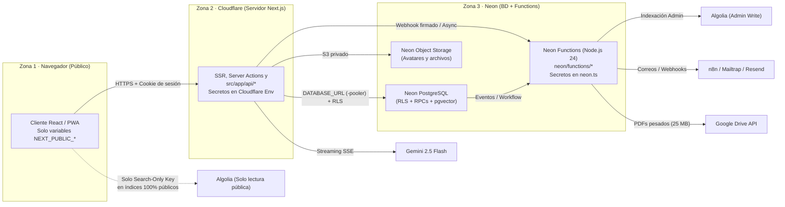

# Guía de Distribución de APIs y Variables: Navegador, Cloudflare (Next.js) y Neon Functions — S.I.G.A.

**Institución:** Escuela Técnica Comercial "Andrés Bello" (Unare II, Puerto Ordaz · Código DEA `OD01340701`)  
**Propósito:** Definir con claridad qué endpoints, integraciones y variables de entorno viven en el **navegador (público)**, cuáles viven en el **servidor de Next.js desplegado en Cloudflare** y cuáles deben ir en **Neon Functions (`neon/functions/`)**.

---

## 1. Respuesta rápida: ¿Todas las APIs deben pasar por Neon Functions?

**No.** En la arquitectura actual de S.I.G.A. (100 % sobre **Neon Serverless Postgres + Better Auth + Neon Object Storage + Neon Functions**):

- **NO todas las APIs pasan por Neon Functions.** La mayoría de las APIs interactivas de la aplicación (autenticación, lecturas/escrituras con RLS, streaming del Tutor IA, avatares, verificación QR) viven directamente en **Next.js (`src/app/api/*` y Server Actions)** ejecutándose en el **servidor de Cloudflare**.
- Lo que **sí es innegociable** en `AGENTS.md` y `.agents/skills/siga-feature-development/SKILL.md` es **cero secretos en el navegador (`NEXT_PUBLIC_*`)**.
- La confusión suele venir de la fase inicial del proyecto (cuando se usaba Supabase como base principal y se recomendaba pasar todo lo de Neon por *Supabase Edge Functions*). Como explica [`neon/functions/README.md`](../neon/functions/README.md), hoy Next.js ya conversa directamente con Neon PostgreSQL en el servidor usando `DATABASE_URL` y RLS.

---

## 2. Las 3 zonas de ejecución y seguridad

Al desplegar S.I.G.A. en **Cloudflare** (Next.js vía OpenNext / Cloudflare Workers o Pages Functions) conectado a **Neon**, existen **tres capas distintas** (más una cuarta capa exclusiva de CI/migraciones):

### Regla práctica para decidir en 10 segundos

| Pregunta | ¿Dónde va la API? |
| :--- | :--- |
| ¿Es un dato o identificador **100 % público** que el navegador necesita leer? | **Zona 1 — Navegador (`NEXT_PUBLIC_*`)** |
| ¿Es una acción **síncrona del usuario** (login, leer/guardar notas, streaming IA, subir avatar, búsqueda autenticada, verificar QR)? | **Zona 2 — Servidor Next.js en Cloudflare (`src/app/api/*` o Server Actions)** |
| ¿Es un **workflow en segundo plano**, webhook de BD, envío de correos, cron, indexación masiva, subida pesada de archivos o sandbox aislado en Node.js 24? | **Zona 3 — Neon Functions (`neon/functions/`)** |
| ¿Aplica migraciones DDL (`npm run db:migrate`) o semillas (`npm run db:seed`)? | **Zona 4 — Solo terminal local o GitHub Actions CI** (`DIRECT_DATABASE_URL`) |

---

## 3. Detalle por zona: qué APIs y claves van en cada lado

### Zona 1 · Parte Pública / Navegador (`NEXT_PUBLIC_*`)

> **Advertencia:** Todo lo que empiece por `NEXT_PUBLIC_` queda embebido en el JavaScript que descarga cualquier visitante. **Nunca** colocar aquí credenciales de escritura, base de datos, IA ni correo.

| Servicio / Uso | Variables permitidas | Condición obligatoria |
| :--- | :--- | :--- |
| **URL del portal** | `NEXT_PUBLIC_APP_URL` | Dominio oficial (`https://siga.etcandresbello.org`). |
| **Analítica de producto (PostHog)** | `NEXT_PUBLIC_POSTHOG_KEY` | Token público de ingesta cliente; sin PII de estudiantes. |
| **Búsqueda pública (Algolia)** *(opcional en cliente)* | `NEXT_PUBLIC_ALGOLIA_APP_ID`, `NEXT_PUBLIC_ALGOLIA_SEARCH_KEY` | **Únicamente** la *Search-Only API Key* restringida a índices públicos sin PII (ej. `siga_pensum` en el Landing). Para índices internos filtrados por rol/mención, preferir Zona 2. |
| **Verificación pública QR (`/verificar`)** | Ninguna clave en cliente | El navegador llama a `GET /api/verificar` (Zona 2), nunca directo a la BD. |

---

### Zona 2 · Servidor Next.js en Cloudflare (`src/app/api/*` y Server Actions)

Aunque la página esté montada en Cloudflare, **los Server Components, Server Actions y Route Handlers corren en servidor privado**, no en el navegador. Sus variables se cargan como **Secrets / Environment Variables en Cloudflare** (sin prefijo `NEXT_PUBLIC_`).

**Qué APIs viven aquí:**

| API / Ruta en S.I.G.A. | Propósito | Variables en Cloudflare (Servidor) |
| :--- | :--- | :--- |
| `/api/auth/[...all]`, `/api/auth/login`, `/api/auth/callback`, `/api/auth/change-password`, `/api/auth/tutor-magic-link` | Better Auth, Google Workspace OAuth (`@etcandresbello.org`), acceso provisional por cédula, Passkeys y Magic Links. | `DATABASE_URL`, `BETTER_AUTH_SECRET`, `GOOGLE_CLIENT_ID`, `GOOGLE_CLIENT_SECRET` |
| **Server Actions** (`src/features/*/actions`) y `/api/analitica/overview`, `/api/notificaciones/feed`, `/api/offline/sync`, `/api/menciones/coordinacion/*` | Operaciones diarias del estudiante, docente y administración bajo RLS y RPCs `SECURITY DEFINER`. | `DATABASE_URL` *(endpoint `-pooler`)* |
| `/api/verificar` | Verificación pública anti-forjamiento de PDFs/QR llamando a `siga_public_verificar_documento` con rate limit. | `DATABASE_URL` |
| `/api/estudiante/avatar` *(y futuros adjuntos ligeros `.webp`)* | Validación de sesión, compresión/verificación y carga hacia **Neon Object Storage**. | `NEON_STORAGE_ENDPOINT`, `NEON_STORAGE_REGION`, `NEON_STORAGE_BUCKET`, `NEON_STORAGE_ACCESS_KEY_ID`, `NEON_STORAGE_SECRET_ACCESS_KEY`, `NEON_STORAGE_PUBLIC_BASE_URL` |
| `/api/ai/tutor`, `/api/ai/docente/planificacion` *(y futuro OCR rápido)* | Streaming en tiempo real con **Vercel AI SDK + Gemini 2.5 Flash** y RAG `pgvector`. Necesita latencia baja y *streaming* directo al cliente. | `GEMINI_API_KEY`, `DATABASE_URL` |
| `/api/search` *(nuevo con Algolia)* | Búsqueda autenticada en **Biblioteca (`1.6`)**, **Cartelera (`1.8`)**, **Empresas (`1.13`)** y `Ctrl+K`, aplicando filtros de rol/mención en servidor (o emitiendo *Secured Search Keys* temporales). | `ALGOLIA_APP_ID`, `ALGOLIA_SEARCH_KEY` |
| **Disparo hacia Neon Functions** | Cuando un Server Action crea un trámite o actualiza un catálogo y avisa de forma firmada a una Neon Function. | `WORKFLOW_WEBHOOK_SECRET` *(y URL de la Neon Function)* |
| **Monitoreo de errores (Sentry)** | Captura de excepciones del servidor en runtime. | `SENTRY_DSN` |

> **Nota sobre Cloudflare Workers:** Evita procesos bloqueantes largos, binarios pesados o librerías que requieran acceso a disco local (`fs`) dentro de `src/app/api/*`. Usa siempre conexiones *pooled*/HTTP hacia Neon (`-pooler` / `@neondatabase/serverless`) y mantén la generación de PDFs en el navegador (`@react-pdf/renderer`, 0 MB en servidor).

---

### Zona 3 · Neon Functions (`neon/functions/`, declaradas en `neon.ts`)

Las **Neon Functions** corren en **Node.js 24** dentro del ecosistema de Neon, reciben `DATABASE_URL` automáticamente por rama (`development`, `main`, etc.) y sus secretos se declaran en [`neon.ts`](../neon.ts) al desplegar con `neon deploy --env .env.local`.

**Qué APIs y trabajos deben ir aquí:**

| Neon Function (activa o planificada) | Propósito | Secretos que vive solo en Neon Functions |
| :--- | :--- | :--- |
| **`studentreqmail`** *(Activa)* | Workflow de trámites estudiantiles: registra notificación in-app, actualiza `workflows.workflow_runs` y dispara correos vía **n8n → Mailtrap**. | `WORKFLOW_WEBHOOK_SECRET`, `N8N_WEBHOOK_URL_STUDENT_REQUEST`, `N8N_WEBHOOK_SECRET`, `CONTROL_ESTUDIOS_NOTIFY_EMAIL`, `SIGA_PORTAL_BASE_URL` |
| **Sincronización e indexación Algolia** *(Planificada)* | Indexar/actualizar/eliminar registros de `library_items`, `school_announcements`, `internship_companies` y `curriculum_subjects` en Algolia de forma asíncrona o masiva sin frenar al usuario ni exponer la llave Admin en Cloudflare. | `ALGOLIA_APP_ID`, `ALGOLIA_ADMIN_API_KEY`, `WORKFLOW_WEBHOOK_SECRET` |
| **Correos transaccionales y resúmenes programados** *(Planificada)* | Alertas de préstamos de biblioteca por vencer, avisos de justificativos resueltos y resúmenes semanales vía Mailtrap / Resend. | `MAILTRAP_API_TOKEN`, `RESEND_API_KEY`, `N8N_*` |
| **Enrutamiento de Informes Finales de Pasantía (PDF ≤ 25 MB)** *(Planificada)* | Subida pesada hacia **Google Drive API** institucional usando SDK de Node.js (evita límites de memoria/tiempo en Cloudflare Workers). | `GOOGLE_DRIVE_CLIENT_EMAIL`, `GOOGLE_DRIVE_PRIVATE_KEY` |
| **Sandbox SQL de Telemática y Snapshots por Lapso** *(Planificada)* | Crear *branches* efímeros en `siga-telematica-labs`, ejecutar SQL sintético con `statement_timeout = 3s`, limpiar ramas vencidas y congelar ramas por cierre de momento vía Neon REST API. | `NEON_LABS_API_KEY`, `NEON_LABS_PROJECT_ID`, `NEON_VAULT_API_KEY` |

---

### Zona 4 · Solo CI / Build / Terminal Local (Nunca en runtime web)

| Variable | Uso exclusivo |
| :--- | :--- |
| `DIRECT_DATABASE_URL` | Migraciones DDL (`npm run db:migrate`) y catálogos base (`npm run db:seed`) sin `-pooler`. |
| `SENTRY_ORG`, `SENTRY_PROJECT`, `SENTRY_AUTH_TOKEN` | Subida de *source maps* durante `next build` en CI/Cloudflare Build, jamás en runtime cliente. |

---

## 4. Caso específico: cómo dividir Algolia entre Cloudflare y Neon

Con el nuevo patrocinio de **Algolia for Open-Source**, la división más limpia y segura es:

1. **En el navegador (Landing público):** opcionalmente `NEXT_PUBLIC_ALGOLIA_APP_ID` + `NEXT_PUBLIC_ALGOLIA_SEARCH_KEY` apuntando **solo** al índice público `siga_pensum` (sin PII) junto al badge obligatorio **"Search by Algolia"** (`https://www.algolia.com/?utm_medium=AOS-referral`).
2. **En Cloudflare (`src/app/api/search/route.ts`):** búsquedas autenticadas de estudiantes/docentes sobre `siga_biblioteca`, `siga_cartelera`, `siga_empresas` y `siga_aranceles`, validando la sesión Better Auth y aplicando los filtros de mención/año del usuario en servidor.
3. **En Neon Functions (`neon/functions/`):** la escritura/indexación con `ALGOLIA_ADMIN_API_KEY` (al crear o editar libros, anuncios, empresas o materias, y en reindexaciones programadas), manteniendo la llave Admin aislada de Cloudflare.

---

## 5. Checklist rápido antes de agregar una nueva API

- [ ] ¿Necesita el navegador conocer esta clave? Si la respuesta es no, **prohibido** usar `NEXT_PUBLIC_`.
- [ ] ¿Responde en tiempo real a un clic del usuario o hace *streaming* (Auth, CRUD con RLS, Tutor IA, búsqueda)? → **`src/app/api/*` o Server Action en Cloudflare**.
- [ ] ¿Es un correo, webhook externo, indexación batch, subida pesada a Drive, cron o gestión de branches? → **Neon Function en `neon/functions/`** declarada en [`neon.ts`](../neon.ts).
- [ ] ¿La ruta valida sesión Better Auth + rol/RLS en servidor y entrada con **Zod**?
- [ ] ¿Queda libre de PII sensible en servicios externos (Algolia, PostHog, Sentry, LLMs)?
