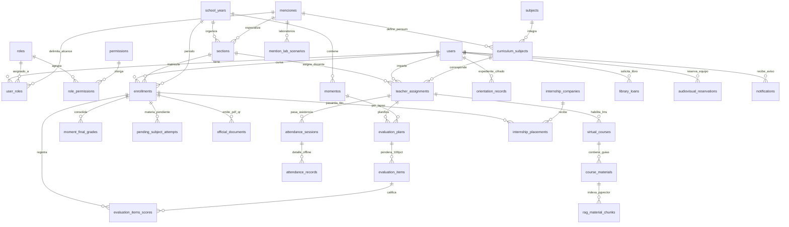

# 00 · Modelo Relacional General de Base de Datos — S.I.G.A.

Este documento define el **diseño relacional definitivo** de **S.I.G.A.** antes de generar código o migraciones SQL. El esquema está diseñado para ser **estable y extensible sin alterar la estructura base**: nuevas funciones se construyen añadiendo filas de permisos, tipos en catálogos o escenarios JSONB validados, sin rediseñar el grafo de tablas principales.

---

## 1. Principios Arquitectónicos y Reglas de Integridad

1. **Separación de Motores (Supabase OLTP vs. Neon Secundario/Labs):**
   - **Supabase PostgreSQL (Motor Primario OLTP):** Fuente única de verdad transaccional, autenticación JWT/Cookies (`auth.users` ↔ `public.users`), autorización granular mediante **Row Level Security (RLS)**, búsqueda vectorial **`pgvector`** y eventos en tiempo real (**Supabase Realtime**).
   - **Neon PostgreSQL Serverless (Aislado vía Supabase Edge Functions):**
     - `siga-vault-analytics`: Respaldo incremental activo, *snapshots* inmutables por Momento Pedagógico y analítica pesada BI (deserción, "materias filtro", SLA).
     - `siga-telematica-labs`: Base de datos aislada con **datos 100 % sintéticos** y rol restringido para prácticas SQL de Telemática.
2. **Estándar de Identificadores y Campos en Venezuela:**
   - **Claves primarias:** `UUID` (`gen_random_uuid()`) en todas las entidades principales, evitando exponer conteos secuenciales en URLs o QR.
   - **Cédula canónica (`cedula`):** Almacenada en formato normalizado `^[VEJ][0-9]{6,9}$` (ej. `V12345678`, sin guiones ni espacios) con índice único parcial `WHERE deleted_at IS NULL`. En UI se formatea `V-12345678`.
   - **Fechas y horas:** `TIMESTAMPTZ` en UTC para eventos/auditoría y `DATE` ISO (`YYYY-MM-DD`) para fechas académicas.
3. **Borrado Lógico (*Soft Delete*) y Concurrencia:**
   - Tablas críticas (`users`, `enrollments`, `library_loans`, `audiovisual_reservations`, `student_scores`) usan `deleted_at TIMESTAMPTZ NULL`.
   - Todas las restricciones de unicidad operan mediante **índices únicos parciales (`WHERE deleted_at IS NULL`)** para permitir re-registros limpios sin romper integridad histórica.
4. **Optimización y Seguridad RLS (Supabase Postgres Best Practices):**
   - **Toda tabla en `public` tiene `ENABLE ROW LEVEL SECURITY`** (sin excepciones).
   - Las políticas RLS envuelven las funciones de sesión en subconsulta escalar `(select auth.uid())` y funciones helper `STABLE SECURITY DEFINER` para evitar evaluaciones por fila (*initPlan optimization*).
   - **Toda clave foránea (`FK`) cuenta con índice B-Tree dedicado** y las consultas frecuentes por momento/sección usan índices compuestos.
   - **RPCs críticos `SECURITY DEFINER`:** Fijan `SET search_path = public, pg_temp`, revocan permisos a `PUBLIC` y `anon`, y verifican identidad y pertenencia como **primera instrucción**.

---

## 2. Diagrama Entidad-Relación General (Vista Global)

---

## 3. Dominio 1 — Identidad, Acceso Híbrido y Tabla Exclusiva de Roles (RBAC)

Este subsistema separa la **identidad técnica (`auth.users`)**, el **perfil institucional (`users`)** y la **gestión exclusiva de roles y permisos (`roles`, `permissions`, `role_permissions`, `user_roles`)**, soportando que un usuario tenga múltiples roles simultáneos (ej. `docente` + `coordinador_mencion` o `docente` + `coordinador_pasantias`).

### 3.1 `users` (Perfil Institucional Unificado)
| Columna | Tipo | Restricciones / Propósito |
| :--- | :--- | :--- |
| `id` | `UUID` | **PK** (`gen_random_uuid()`). Identificador canónico interno referenciado por todas las tablas de negocio. |
| `auth_user_id` | `UUID` | **UNIQUE**, FK a `auth.users(id)` (`ON DELETE SET NULL`). Vínculo con Supabase Auth. |
| `cedula` | `TEXT` | **NOT NULL**, `CHECK (cedula ~ '^[VEJ][0-9]{6,9}$')`. Único parcial `WHERE deleted_at IS NULL`. |
| `first_name` / `last_name` | `TEXT` | **NOT NULL**. Nombres y apellidos legales según documento de identidad. |
| `institutional_email` | `TEXT` | **NULLABLE** en estado provisional; cuando existe debe validar `@etcandresbello.org` (`CHECK (institutional_email ~* '^[^@]+@etcandresbello\\.org$')`). Único parcial. |
| `recovery_email` | `TEXT` | Correo secundario personal opcional **solo para recuperación o notificaciones**, jamás como credencial principal OAuth. |
| `access_tier` | `TEXT` | **NOT NULL**, `CHECK (access_tier IN ('provisional_cedula', 'verified_workspace', 'suspended'))`. |
| `workspace_verified_at` | `TIMESTAMPTZ` | Marca de tiempo de vinculación exitosa con Google Workspace `@etcandresbello.org`. |
| `phone` | `TEXT` | Teléfono de contacto normalizado (formato Venezuela). |
| `avatar_webp_url` | `TEXT` | Foto tipo carnet optimizada en `.webp`. |
| `qr_token_secret` | `UUID` | Semilla criptográfica para firmar el QR dinámico del Carnet Digital. |
| `is_active` | `BOOLEAN` | `DEFAULT true`. |
| `created_at`, `updated_at`, `deleted_at` | `TIMESTAMPTZ` | Trazabilidad y borrado lógico. |

### 3.2 `roles` (Tabla Exclusiva de Roles)
Catálogo maestro y cerrado extensible sin alterar columnas de usuario:

| Columna | Tipo | Restricciones / Propósito |
| :--- | :--- | :--- |
| `id` | `UUID` | **PK**. |
| `code` | `TEXT` | **UNIQUE NOT NULL**. Valores semilla iniciales: `estudiante`, `docente`, `coordinador_mencion`, `coordinador_pasantias`, `control_estudios`, `orientacion`, `biblioteca`, `direccion`. |
| `name` | `TEXT` | **NOT NULL**. Nombre legible (ej. *"Coordinación de Mención Técnica"*). |
| `description` | `TEXT` | Alcance oficial del rol dentro del plantel. |
| `hierarchy_level` | `SMALLINT` | **NOT NULL**. Nivel jerárquico referencial (`10` estudiante, `20` docente, `40` coordinaciones/biblioteca/orientación/control, `90` dirección). |
| `requires_workspace` | `BOOLEAN` | `DEFAULT true`. Solo `estudiante` admite ingreso temporal `provisional_cedula`; todo personal exige `@etcandresbello.org`. |
| `is_system` | `BOOLEAN` | `DEFAULT true`. Impide eliminar roles núcleo del sistema. |
| `is_active` | `BOOLEAN` | `DEFAULT true`. |

### 3.3 `permissions` y `role_permissions` (Permisos Granulares Extensibles)
Permite crecer en funciones futuras insertando permisos sin tocar tablas ni reescribir asignaciones de usuarios:

- **`permissions`**: `id (UUID PK)`, `code (TEXT UNIQUE)` (ej. `grades.write_open_moment`, `grades.reopen_closed_moment`, `orientation.read_confidential`, `pasantias.manage_companies`, `analytics.view_institutional`, `rbac.assign_roles`), `module (TEXT)`, `description (TEXT)`.
- **`role_permissions`**: `role_id (UUID FK -> roles.id)`, `permission_id (UUID FK -> permissions.id)`, **PK compuesta `(role_id, permission_id)`**.

### 3.4 `user_roles` (Asignación Multi-Rol con Alcance Opcional)
| Columna | Tipo | Restricciones / Propósito |
| :--- | :--- | :--- |
| `id` | `UUID` | **PK**. |
| `user_id` | `UUID` | **NOT NULL**, FK a `users(id)`. Indexado. |
| `role_id` | `UUID` | **NOT NULL**, FK a `roles(id)`. Indexado. |
| `mencion_id` | `UUID` | **NULLABLE**, FK a `menciones(id)`. Obligatorio cuando el rol es `coordinador_mencion` para acotarlo a *Telemática*, *Aduanas* o *Turismo*. |
| `assigned_by` | `UUID` | **NULLABLE**, FK a `users(id)`. Autoridad que otorgó el rol. |
| `valid_from` / `valid_until` | `DATE` | Vigencia temporal opcional (útil para encargadurías o años escolares). |
| `is_active` | `BOOLEAN` | `DEFAULT true`. |
| `created_at` | `TIMESTAMPTZ` | Fecha de asignación. |
| **Índice Único** | — | `(user_id, role_id, COALESCE(mencion_id, '00000000-0000-0000-0000-000000000000')) WHERE is_active = true`. |

### 3.5 `identity_verifications` (Flujo Provisional Cédula → Workspace)
- Registra intentos de activación, vínculo de cuenta provisional por `cedula` con `@etcandresbello.org` y tokens temporales de verificación para correo de recuperación: `id`, `user_id`, `verification_type` (`workspace_link`, `recovery_email`, `provisional_pin_reset`), `token_hash`, `expires_at`, `verified_at`, `created_at`.

---

## 4. Dominio 2 — Estructura Académica MPPE, Matrícula y Expediente

### 4.1 Tablas Estructurales del Plantel
- **`school_years`**: `id (UUID PK)`, `code (TEXT UNIQUE)` (ej. `2026-2027`), `name`, `start_date`, `end_date`, `status` (`draft`, `active`, `closed`), `is_current (BOOLEAN — máximo uno true mediante índice único parcial)`.
- **`momentos`**: `id (UUID PK)`, `school_year_id (FK)`, `number (SMALLINT CHECK IN (1, 2, 3))`, `name`, `start_date`, `end_date`, `grade_entry_open_at`, `grade_entry_close_at`, `status` (`scheduled`, `open`, `locked`, `closed`), `UNIQUE (school_year_id, number)`.
- **`menciones`**: `id (UUID PK)`, `code (TEXT UNIQUE)` (`TELEMATICA`, `ADUANAS`, `TURISMO`), `name`, `description`, `is_active`.
- **`subjects`**: `id (UUID PK)`, `code (TEXT UNIQUE)`, `name`, `grading_scale` (`NUMERIC_1_20`, `LITERAL_A_E`), `passing_threshold` (`SMALLINT DEFAULT 10`), `is_technical_core (BOOLEAN)`.
- **`curriculum_subjects`** (Malla oficial 1.º a 6.º año por mención): `id (UUID PK)`, `mencion_id (FK)`, `subject_id (FK)`, `grade_year (SMALLINT CHECK 1..6)`, `weekly_hours (SMALLINT)`, `is_active (BOOLEAN)`, `UNIQUE (mencion_id, subject_id, grade_year)`.
- **`sections`**: `id (UUID PK)`, `school_year_id (FK)`, `mencion_id (FK)`, `grade_year (SMALLINT CHECK 1..6)`, `section_letter (TEXT)` (ej. `A`, `B`, `U`), `capacity (SMALLINT)`, `UNIQUE (school_year_id, mencion_id, grade_year, section_letter) WHERE deleted_at IS NULL`.
- **`teacher_assignments`** (Carga horaria docente): `id (UUID PK)`, `school_year_id (FK)`, `section_id (FK)`, `curriculum_subject_id (FK)`, `teacher_user_id (FK -> users.id)`, `is_active (BOOLEAN)`, `UNIQUE (school_year_id, section_id, curriculum_subject_id) WHERE is_active = true`.

### 4.2 Matrícula, Expediente y Trámites Estudiantiles
- **`enrollments`** (Matrícula anual del estudiante):
  - `id (UUID PK)`, `student_user_id (FK -> users.id)`, `school_year_id (FK)`, `section_id (FK)`, `mencion_id (FK)`, `grade_year (SMALLINT CHECK 1..6)`.
  - `enrollment_status` (`pre_enrolled`, `active`, `promoted`, `withdrawn`, `graduated`).
  - `enrollment_type` (`regular`, `new_entry`, `transfer_equivalence`).
  - `emergency_contact_name`, `emergency_contact_cedula`, `emergency_contact_phone`, `emergency_contact_relationship` *(resguardo administrativo en Control de Estudios sin crear portal ni cuenta de Representantes)*.
  - `ocr_extracted_metadata (JSONB)` *(datos estructurados extraídos por IA OCR durante la inscripción)*.
  - Índice único parcial: `(student_user_id, school_year_id) WHERE deleted_at IS NULL`.
- **`student_dossier_documents`** (Recaudos digitalizados del expediente):
  - `id (UUID PK)`, `student_user_id (FK)`, `document_type` (`cedula`, `birth_certificate`, `grade_certification`, `photo`, `medical_note`, `other`), `storage_path`, `ocr_verified (BOOLEAN)`, `verified_by (FK -> users.id)`, `created_at`.
- **`student_requests`** (Trámites Express de Alumnos hacia Secretaría):
  - `id (UUID PK)`, `student_user_id (FK)`, `enrollment_id (FK)`, `request_type` (`constancia_estudio`, `constancia_inscripcion`, `solvencia`, `revision_notas`, `activacion_workspace`), `reason`, `status` (`pending`, `in_review`, `approved`, `rejected`, `delivered`), `sla_entered_at`, `resolved_at`, `resolved_by (FK -> users.id)`, `official_document_id (FK NULLABLE)`.

---

## 5. Dominio 3 — Evaluación Ponderada, Calificaciones MPPE y Auditoría Inmutable

### 5.1 Plan de Evaluación Ponderado y Notas Parciales
- **`evaluation_plans`**: `id (UUID PK)`, `teacher_assignment_id (FK)`, `momento_id (FK)`, `title`, `planning_ai_notes (TEXT)`, `status` (`draft`, `published`, `locked`), `UNIQUE (teacher_assignment_id, momento_id)`.
- **`evaluation_items`**: `id (UUID PK)`, `evaluation_plan_id (FK)`, `title`, `evaluation_type` (`exam_online`, `assignment_lms`, `lab_mention`, `classroom_activity`, `project`), `weight_percent (NUMERIC(5,2) CHECK > 0 AND <= 100)`, `max_points (NUMERIC(5,2) DEFAULT 20)`, `scheduled_date (DATE)`, `linked_assignment_id (UUID NULLABLE)`, `linked_exam_id (UUID NULLABLE)`. *(Trigger/RPC valida que la suma de `weight_percent` por plan sea `= 100.00` antes de cerrar plan).*
- **`student_scores`**: `id (UUID PK)`, `evaluation_item_id (FK)`, `enrollment_id (FK)`, `numeric_score (NUMERIC(5,2) CHECK >= 0 AND <= 20)`, `literal_grade (TEXT NULLABLE CHECK IN ('A','B','C','D','E'))`, `source` (`manual`, `lms_exam_sync`, `lms_assignment`, `mention_lab`), `recorded_by (FK -> users.id)`, `created_at`, `updated_at`, `deleted_at`, `UNIQUE (evaluation_item_id, enrollment_id) WHERE deleted_at IS NULL`.

### 5.2 Calificaciones Oficiales MPPE, Materias Pendientes y Auditoría
- **`moment_final_grades`**: `id (UUID PK)`, `enrollment_id (FK)`, `curriculum_subject_id (FK)`, `momento_id (FK)`, `raw_weighted_avg (NUMERIC(5,2))`, `final_numeric (SMALLINT CHECK 1..20 NULLABLE)`, `final_literal (TEXT CHECK IN ('A','B','C','D','E') NULLABLE)`, `qualitative_observation (TEXT)` *(sugerida por IA y aprobada por el docente)*, `is_locked (BOOLEAN DEFAULT false)`, `reopened_until (TIMESTAMPTZ NULLABLE)`, `approved_by (FK -> users.id)`, `UNIQUE (enrollment_id, curriculum_subject_id, momento_id)`.
- **`pending_subject_attempts`** (Materias Pendientes — hasta 4 momentos reglamentarios):
  - `id (UUID PK)`, `student_user_id (FK)`, `school_year_id (FK)`, `curriculum_subject_id (FK)` *(del año reprobado)*, `attempt_number (SMALLINT CHECK IN (1, 2, 3, 4))`, `exam_date (DATE)`, `final_numeric (SMALLINT CHECK 1..20)`, `passed (BOOLEAN GENERATED/COMPUTED)`, `evaluator_user_id (FK)`, `UNIQUE (student_user_id, school_year_id, curriculum_subject_id, attempt_number)`.
- **`grade_audit_logs`** (Bitácora inmutable MPPE):
  - `id (UUID PK)`, `target_table (TEXT)`, `target_record_id (UUID)`, `enrollment_id (UUID)`, `actor_user_id (FK -> users.id)`, `action` (`insert`, `update`, `reopen_moment`, `lock_moment`, `equivalence`), `previous_value (JSONB)`, `new_value (JSONB)`, `reason (TEXT)`, `ip_hash (TEXT)`, `created_at (TIMESTAMPTZ NOT NULL DEFAULT now())`.
  - **Protección física:** Trigger `BEFORE UPDATE OR DELETE` que lanza excepción impidiendo alterar o borrar cualquier fila histórica.
- **`official_documents`** (Registro criptográfico para PDFs client-side y `/verificar`):
  - `id (UUID PK)`, `verification_code (TEXT UNIQUE)` (ej. `SIGA-2026-XXXXXX`), `document_hash (TEXT UNIQUE NOT NULL)`, `document_type` (`boletin_momento`, `constancia_estudio`, `constancia_inscripcion`, `certificacion_notas`, `carta_postulacion_pasantia`, `carta_aceptacion_pasantia`), `student_user_id (FK)`, `issued_by (FK -> users.id)`, `payload_snapshot (JSONB NOT NULL)` *(datos no sensibles/mínimos para validar integridad)*, `status` (`valid`, `revoked`), `issued_at (TIMESTAMPTZ)`, `revoked_at (TIMESTAMPTZ NULL)`.

---

## 6. Dominio 4 — Asistencia Offline-First, Diario de Clases e Inasistencia Docente

- **`attendance_sessions`**: `id (UUID PK)`, `teacher_assignment_id (FK)`, `momento_id (FK)`, `session_date (DATE)`, `block_label (TEXT)`, `recorded_mode` (`online`, `offline_pwa`, `qr_scan`), `created_by (FK -> users.id)`, `synced_at (TIMESTAMPTZ)`, `UNIQUE (teacher_assignment_id, session_date, block_label)`.
- **`attendance_records`**: `id (UUID PK)`, `attendance_session_id (FK)`, `enrollment_id (FK)`, `status` (`present`, `absent`, `late`, `justified`), `note (TEXT)`, `client_mutation_id (UUID UNIQUE NOT NULL)` *(garantiza idempotencia en sincronización IndexedDB)*, `UNIQUE (attendance_session_id, enrollment_id)`.
- **`class_diary_entries`**: `id (UUID PK)`, `teacher_assignment_id (FK)`, `entry_date (DATE)`, `topic_covered (TEXT NOT NULL)`, `classroom_incidents (TEXT)`, `derive_to_orientation (BOOLEAN DEFAULT false)`, `author_user_id (FK -> users.id)`, `created_at`.
- **`teacher_absences`** (Aviso de inasistencia docente para reorganización horaria en Coordinación):
  - `id (UUID PK)`, `teacher_user_id (FK)`, `absence_date (DATE)`, `affected_blocks (JSONB)`, `reason_category` (`medical`, `personal`, `institutional`), `observation (TEXT)`, `status` (`reported`, `acknowledged`, `reorganized`), `reviewed_by (FK -> users.id NULLABLE)`, `created_at`.

---

## 7. Dominio 5 — Aula Virtual LMS Unificada (`/aula-virtual`), Tutor Socrático RAG (`pgvector`) y Menciones Técnicas

### 7.1 Aula Virtual Única (LMS) y Tutor IA
El LMS opera como un único campus integrado dentro de S.I.G.A. donde confluyen docentes y estudiantes mediante la cadena relacional `teacher_assignments` (1:1 `virtual_courses`) ↔ `sections` / `school_years` ↔ `enrollments`, filtrada por **RLS** (`pol_virtual_courses_select` y `siga_internal.teaches_assignment`):

- **`virtual_courses`**: `id (UUID PK)`, `teacher_assignment_id (UUID UNIQUE FK)`, `welcome_message`, `ai_tutor_enabled (BOOLEAN DEFAULT true)`, `is_published (BOOLEAN)`. *(Lectura para docentes de la asignación, coordinadores de la mención, Control/Dirección y alumnos `verified_workspace` matriculados en la misma `section_id` y `school_year_id` cuando `is_published = true`).*
- **`course_modules`**: `id (UUID PK)`, `virtual_course_id (FK)`, `title`, `sort_order (INT)`, `is_visible (BOOLEAN)`.
- **`course_materials`**: `id (UUID PK)`, `course_module_id (FK)`, `title`, `material_type` (`pdf`, `slides`, `video_link`, `code_snippet`, `guide`), `storage_path_or_url`, `rag_status` (`pending`, `indexed`, `failed`, `not_applicable`), `created_at`.
- **`rag_material_chunks`**: `id (UUID PK)`, `course_material_id (FK)`, `virtual_course_id (FK)` *(desnormalizado para filtrado rápido RLS/RAG por curso/mención)*, `chunk_index (INT)`, `content (TEXT)`, `embedding (VECTOR(768))` *(índice `HNSW` para similitud coseno; consultado mediante `public.siga_match_rag_chunks`)*.
- **`assignments`**: `id (UUID PK)`, `course_module_id (FK)`, `title`, `instructions`, `due_at (TIMESTAMPTZ)`, `allow_late (BOOLEAN DEFAULT true)`, `rubric_json (JSONB)`.
- **`assignment_submissions`**: `id (UUID PK)`, `assignment_id (FK)`, `enrollment_id (FK)`, `file_path`, `text_answer`, `submitted_at`, `is_late (BOOLEAN)`, `ai_pre_evaluation (JSONB)` *(sugerencia según rúbrica + índice de similitud/duplicado)*, `teacher_feedback (TEXT)`, `UNIQUE (assignment_id, enrollment_id)`.
- **`online_exams`**: `id (UUID PK)`, `virtual_course_id (FK)`, `title`, `opens_at`, `closes_at`, `duration_minutes`, `max_attempts (SMALLINT DEFAULT 1)`, `sync_to_evaluation_item_id (UUID NULLABLE FK)`.
- **`exam_questions`**: `id (UUID PK)`, `online_exam_id (FK)`, `question_type` (`single_choice`, `multiple_choice`, `true_false`), `prompt`, `options_json (JSONB)`, `correct_answer_json (JSONB)` *(protegido por RLS: nunca expuesto directamente al estudiante; se sirve sin respuestas mediante `public.siga_get_exam_questions_student(p_online_exam_id)`)*.
- **`exam_attempts`**: `id (UUID PK)`, `online_exam_id (FK)`, `enrollment_id (FK)`, `started_at`, `submitted_at`, `answers_json (JSONB)`, `computed_score (NUMERIC(5,2))`, `attempt_number (SMALLINT)`. *(Evaluado y calificado en servidor mediante `public.siga_submit_exam_attempt(p_online_exam_id, p_answers)`, sincronizando automáticamente a `student_scores` si existe `sync_to_evaluation_item_id`)*.
- **`ai_tutor_threads`** y **`ai_tutor_messages`**: Historial de conversaciones socráticas por `student_user_id` + `virtual_course_id`, guardando `citations_json` (chunks reales del profesor utilizados como respaldo).

> **Nota de implementación en consultas SSR/RLS (`00001_initial_baseline.sql`):** En las tablas hijas `course_modules`, `course_materials`, `assignments` y `online_exams`, las consultas desde Next.js deben resolver y filtrar siempre por el `virtual_course_id` autorizado vía `virtual_courses`, y se recomienda añadir verificación explícita por matrícula/sección en una nueva migración de BD antes de pasar a producción.

### 7.2 Entornos Prácticos Extensibles por Mención Técnica (1.º a 6.º Año)
Integrados dentro del mismo `/aula-virtual` (`/aula-virtual/{telematica,aduanas,turismo}`) de forma **unificada y extensible** para no crear nuevas tablas cuando se añadan nuevos simuladores:

- **`mention_lab_scenarios`**:
  - `id (UUID PK)`, `mencion_id (FK)`, `grade_year (SMALLINT CHECK 1..6)`, `tool_type` (`telematica_sql`, `telematica_network`, `telematica_support_log`, `aduanas_tariff`, `aduanas_cif_fob`, `aduanas_documentary`, `turismo_routes`, `turismo_events`, `turismo_reception`), `title`, `instructions`, `is_base_catalog (BOOLEAN)`, `created_by (FK -> users.id)`, `config_json (JSONB NOT NULL)` *(aranceles modelo, topología IP, rutas de Guayana, campos B/L o esquema sintético de laboratorio en Neon)*, `evaluation_item_id (UUID NULLABLE FK)`.
- **`mention_lab_submissions`**:
  - `id (UUID PK)`, `scenario_id (FK)`, `enrollment_id (FK)`, `submission_payload (JSONB NOT NULL)` *(queries ejecutadas en Neon, cálculo CIF/FOB, ficha check-in, bitácora de ensamblaje TI)*, `auto_check_result (JSONB)`, `teacher_score (NUMERIC(5,2) NULLABLE)`, `feedback (TEXT)`, `submitted_at (TIMESTAMPTZ)`.

---

## 8. Dominio 6 — Orientación y Psicopedagogía (Confidencialidad Reforzada K12)

> **Regla inviolable:** Ninguna tabla de este dominio se publica en `supabase_realtime`, y sus políticas RLS restringen `SELECT`/`INSERT`/`UPDATE` **exclusivamente** a usuarios activos con rol `orientacion` o `direccion`. Docentes, coordinadores de mención, alumnos y terceros no tienen visibilidad alguna.

- **`orientation_records`**: `id (UUID PK)`, `student_user_id (FK -> users.id)`, `school_year_id (FK)`, `case_code (TEXT UNIQUE)`, `record_category` (`acta_compromiso`, `acuerdo_convivencia`, `vulnerabilidad_socioeconomica`, `seguimiento_psicopedagogico`), `summary (TEXT)`, `confidential_notes_encrypted (TEXT)`, `risk_level` (`low`, `medium`, `high`), `opened_by (FK -> users.id)`, `status` (`open`, `monitoring`, `closed`), `created_at`, `updated_at`.
- **`orientation_followups`**: `id (UUID PK)`, `orientation_record_id (FK)`, `session_date (DATE)`, `observations (TEXT)`, `agreements (TEXT)`, `next_review_date (DATE)`, `recorded_by (FK -> users.id)`, `created_at`.

---

## 9. Dominio 7 — Pasantías y Servicio Comunitario (6.º Año)

- **`internship_companies`**: `id (UUID PK)`, `rif (TEXT UNIQUE)`, `business_name`, `sector` (`telematica`, `aduanas`, `turismo`, `administracion`), `parish_zone (TEXT)` *(sector en Puerto Ordaz/Ciudad Guayana para matchmaking geográfico)*, `address`, `contact_name`, `contact_email`, `contact_phone`, `available_slots (SMALLINT)`, `is_active (BOOLEAN)`.
- **`internship_placements`**: `id (UUID PK)`, `enrollment_id (FK)`, `company_id (FK)`, `academic_tutor_user_id (FK -> users.id)`, `company_tutor_name`, `company_tutor_email`, `ai_match_score (NUMERIC(5,2))`, `start_date`, `end_date`, `status` (`candidate`, `postulated`, `active`, `completed`, `cancelled`), `UNIQUE (enrollment_id)`.
- **`internship_weekly_logs`**: `id (UUID PK)`, `placement_id (FK)`, `week_number (SMALLINT)`, `hours_logged (NUMERIC(4,1))`, `activities_summary (TEXT)`, `tutor_approved (BOOLEAN)`, `tutor_comment (TEXT)`, `UNIQUE (placement_id, week_number)`.
- **`internship_reports`**: `id (UUID PK)`, `placement_id (FK)`, `version_number (SMALLINT)`, `file_path_or_drive_id`, `ai_normative_review (JSONB)` *(hallazgos en tercera persona, tiempos verbales en pasado, estructura formal)*, `academic_status` (`draft`, `ai_reviewed`, `submitted`, `approved`, `changes_requested`), `created_at`.
- **`internship_magic_links`**: `id (UUID PK)`, `placement_id (FK)`, `token_hash (TEXT UNIQUE NOT NULL)`, `tutor_email`, `expires_at (TIMESTAMPTZ NOT NULL)`, `used_at (TIMESTAMPTZ NULL)`, `max_uses (SMALLINT DEFAULT 1)`. *(Única puerta externa acotada con rate-limit para tutores empresariales sin cuenta).*
- **`internship_evaluations`**: `id (UUID PK)`, `placement_id (FK)`, `evaluator_type` (`company_tutor`, `academic_tutor`), `magic_link_id (UUID NULLABLE FK)`, `rubric_scores_json (JSONB NOT NULL)`, `final_score (NUMERIC(5,2))`, `observations (TEXT)`, `submitted_at`.

---

## 10. Dominio 8 — Biblioteca Escolar y Equipos Audiovisuales

- **`library_items`**: `id (UUID PK)`, `qr_code (TEXT UNIQUE NOT NULL)`, `title`, `author`, `item_type` (`book`, `technical_manual`, `thesis_project`, `reference`), `mencion_id (UUID NULLABLE FK)`, `total_copies (SMALLINT)`, `available_copies (SMALLINT)`, `cover_webp_url (TEXT)`, `is_active (BOOLEAN)`.
- **`library_loans`**: `id (UUID PK)`, `library_item_id (FK)`, `borrower_user_id (FK -> users.id)`, `issued_by_user_id (FK -> users.id)`, `loaned_at (TIMESTAMPTZ)`, `due_date (DATE)`, `returned_at (TIMESTAMPTZ NULL)`, `status` (`active`, `overdue`, `returned`, `lost`), `deleted_at (TIMESTAMPTZ NULL)`.
- **`audiovisual_resources`**: `id (UUID PK)`, `asset_qr_code (TEXT UNIQUE NOT NULL)`, `name` (ej. *Videobeam Epson #2*, *Laptop Aula 4*), `category` (`videobeam`, `laptop`, `audio`, `didactic_kit`), `condition_status` (`available`, `damaged`, `retired`).
- **`audiovisual_reservations`**: `id (UUID PK)`, `resource_id (FK)`, `teacher_user_id (FK -> users.id)`, `reserved_date (DATE)`, `block_start (TIME)`, `block_end (TIME)`, `purpose (TEXT)`, `status` (`reserved`, `checked_out`, `returned`, `cancelled`), `deleted_at`. *(Restricción de no solapamiento horario mediante lock transaccional / `EXCLUDE USING gist` o RPC con `pg_advisory_xact_lock`).*

---

## 11. Dominio 9 — Notificaciones Internas (In-App + Correo)

Sin Web Push ni Telegram Bot; todas las notificaciones operan exclusivamente dentro de la bandeja in-app y/o correo electrónico vía Edge Function:

- **`notifications`**:
  - `id (UUID PK)`, `recipient_user_id (FK -> users.id)`, `category` (`academic_grade`, `lms_task`, `library_due`, `pasantias`, `request_status`, `teacher_absence`, `sla_alert`, `early_risk`), `title`, `body`, `action_url`, `is_read (BOOLEAN DEFAULT false)`, `read_at (TIMESTAMPTZ NULL)`, `created_at (TIMESTAMPTZ DEFAULT now())`. *(Publicada en `supabase_realtime` filtrada por `recipient_user_id = (select current_internal_user_id())`)*.
- **`notification_email_logs`**:
  - `id (UUID PK)`, `notification_id (UUID NULLABLE FK)`, `recipient_email (TEXT)` *(institucional `@etcandresbello.org` o `recovery_email`)*, `provider` (`mailtrap`, `resend`), `template_code (TEXT)`, `status` (`queued`, `sent`, `failed`), `provider_message_id (TEXT)`, `created_at`.

---

## 12. Esquemas en Neon PostgreSQL Serverless (Vía Edge Functions Únicamente)

Next.js nunca se conecta directamente a Neon; únicamente las **Supabase Edge Functions (Deno)** consumen `NEON_VAULT_DATABASE_URL` y `NEON_LABS_DATABASE_URL`.

### 12.1 Proyecto Neon A: `siga-vault-analytics` (Respaldo Activo + Analítica BI)
- **`sync_watermarks`**: Control de marcas de agua incrementales por tabla replicada desde Supabase (`table_name PK`, `last_synced_updated_at`, `rows_synced`, `status`).
- **`mirror_*` (Tablas espejo desidentificadas / cifradas de respaldo):** Réplica incremental de `school_years`, `menciones`, `sections`, `curriculum_subjects`, `enrollments`, `moment_final_grades`, `pending_subject_attempts`, `attendance_records`, `grade_audit_logs`, `official_documents`.
- **`moment_snapshots`**: Cortes inmutables en formato `JSONB` al cerrar cada Momento Pedagógico (1, 2 y 3) para reconstrucción histórica garantizada ante cualquier incidente.
- **`analytics_student_risk`:** Resultados precalculados de deserción/riesgo académico por estudiante/momento (`risk_score`, `factors_json`, `computed_at`) consultados por Dirección sin sobrecargar Supabase.
- **`analytics_subject_stats` y `analytics_sla_metrics`:** Vistas agregadas para "Materias Filtro", semáforo de carga docente, tiempos de Secretaría y matrices estadísticas CDCE / Zona Educativa.

### 12.2 Proyecto Neon B: `siga-telematica-labs` (Laboratorios SQL Aislados)
- **`lab_sandbox_sessions`**: Trazabilidad de sesiones SQL ejecutadas por estudiantes de Telemática (`student_hash`, `scenario_code`, `executed_sql`, `row_count`, `duration_ms`, `executed_at`).
- **`practice_*` (Datasets 100 % sintéticos):** Tablas didácticas de comercio, inventario y biblioteca ficticias sobre un rol de PostgreSQL con permisos mínimos (`SELECT`, o `TEMP`/transacción `ROLLBACK` con `statement_timeout = 3s`, sin acceso a red externa ni a esquemas administrativos).

---

## 13. Matriz Resumida de Políticas RLS por Rol Exclusivo

| Dominio / Tabla | `estudiante` (Workspace) | `estudiante` (`provisional_cedula`) | `docente` | `coordinador_mencion` | `control_estudios` | `orientacion` | `coordinador_pasantias` | `biblioteca` | `direccion` |
| :--- | :--- | :--- | :--- | :--- | :--- | :--- | :--- | :--- | :--- |
| **`users` (propio) / `roles`** | Lectura propio | Lectura propio (limitado) | Lectura propio + alumnos asignados | Lectura mención | Lectura/Alta estudiantes y personal | Lectura básica estudiante | Lectura 6.º año | Lectura básica prestatarios | Total |
| **`enrollments`, `moment_final_grades`** | Lectura propio | Lectura inscripción propia | Lectura/Escritura (su asignación + momento abierto) | Lectura su mención | Total (con auditoría) | Lectura básica académica | Lectura 6.º año | Sin acceso a notas | Total |
| **`grade_audit_logs`** | Sin acceso | Sin acceso | Sin acceso | Lectura su mención | Lectura (inmutable) | Sin acceso | Sin acceso | Sin acceso | Lectura (inmutable) |
| **`virtual_courses`, `mention_lab_*`** | Lectura/Entrega sus cursos | **Bloqueado** | CRUD sus cursos | Supervisión su mención | Lectura soporte | Sin acceso | Sin acceso | Sin acceso | Lectura |
| **`orientation_records`, `followups`** | **Bloqueado** | **Bloqueado** | **Bloqueado** | **Bloqueado** | **Bloqueado** | **Total (Cifrado)** | **Bloqueado** | **Bloqueado** | **Total (Cifrado)** |
| **`internship_*`** | Propio (6.º año) | **Bloqueado** | Lectura/Evaluación si es tutor | Lectura su mención (6.º) | Lectura actas finales | Sin acceso | **Total** | Sin acceso | Total |
| **`library_*`, `audiovisual_*`** | Catálogo + préstamos propios | **Bloqueado** | Catálogo + reservas audiovisuales | Igual docente | Lectura solvencias | Igual docente | Igual docente | **Total** | Total |
| **`analytics_*` (Neon vía Edge)** | **Bloqueado** | **Bloqueado** | **Bloqueado** | Indicadores de su mención | Reportes Secretaría/CDCE | Indicadores riesgo propios | Indicadores pasantías | Uso biblioteca | **Total BI** |
