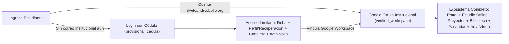

# 01 · Sección Alumnos — Documentación Maestra de Módulos (S.I.G.A.)

**Institución:** Escuela Técnica Comercial (E.T.C.) "Andrés Bello" · Unare II, Puerto Ordaz, Estado Bolívar · Código DEA `OD01340701`  
**Perfil cubierto:** `estudiante` (niveles `provisional_cedula` para nuevo ingreso y `verified_workspace` con cuenta institucional `@etcandresbello.org`).  
**Menciones oficiales vigentes (1.º a 6.º año):** *Aduana* (Economía Social), *Turismo* (Economía Social) y *Telemática* (Industrial) · Carga horaria oficial: `40 h/sem` (1.º–2.º), `42 h/sem` (3.º–5.º) y `1440 h/año escolar` de *Práctica Profesional* en 6.º año.  
**Documentos relacionados:** [00-MODELO-RELACIONAL-BD.md](./00-MODELO-RELACIONAL-BD.md) · [04-AULA-VIRTUAL.md](./04-AULA-VIRTUAL.md) *(Aula Virtual LMS, Tutor Socrático IA 24/7 y Entornos Prácticos por Mención)*.

---

## Mapa General de Módulos de la Sección Estudiante

| Código | Módulo | Ruta Principal | Frecuencia de Uso |
| :--- | :--- | :--- | :--- |
| **1.1** | Portal del Estudiante, Simulador de Notas, Horario y Carnet QR | `/estudiante` | Diario / Semanal |
| **1.2** | Asignaturas, Plan de Estudios Oficial y Expediente por Área | `/estudiante/asignaturas` | Semanal |
| **1.3** | Trámites Express y Documentos Verificables QR | `/estudiante/tramites` | Bajo demanda |
| **1.4** | Perfil, Fotografía `.webp`, Seguridad y Apariencia | `/estudiante/perfil` | Ocasional |
| **1.5** | Bandeja de Notificaciones Internas (In-App + Tiempo Real) | `/notificaciones` | Diario |
| **1.6** | Biblioteca Escolar Digital y Repositorio de Informes | `/biblioteca` *(vista alumno)* | Semanal |
| **1.7** | Mi Día Escolar, Ausencias Docentes y Semáforo de Asistencia (75 %) | `/estudiante/asistencia` | Diario |
| **1.8** | La Cartelera Bellista (Anuncios Oficiales, Contingencias y Eventos) | `/estudiante/cartelera` | Diario |
| **1.9** | Zona de Estudio Offline (Agenda Personal, Flashcards y Pomodoro) | `/estudiante/estudio` | Diario |
| **1.10** | Gestor de Proyecto Socioproductivo (Área PEST · 8 h/semana) | `/estudiante/proyectos` | Semanal |
| **1.11** | Justificativos Digitales de Inasistencia (Reposos y Representante) | `/estudiante/asistencia?vista=justificativos` | Bajo demanda |
| **1.12** | Orientación y Bienestar (Citas Confidenciales y Guía Vocacional) | `/estudiante/orientacion` | Mensual / Bajo demanda |
| **1.13** | Portal del Pasante (6.º Año · 1440 h) y Empresas de Guayana | `/pasantias` *(vista alumno)* | Diario (6.º año) |
| **1.14** | Portafolio Técnico y Hoja de Vida Verificada (PDF + QR) | `/estudiante/portafolio` | Trimestral / Egreso |
| **1.15** | Boletín Histórico y Récord Académico Multianual (1.º–6.º) | `/estudiante/historial` | Trimestral / Anual |

---

## Arquitectura Transversal de Acceso Estudiantil

### Flujo de Ingreso (`provisional_cedula` → `@etcandresbello.org`)
- **Objetivo:** Garantizar que solo miembros reales de la E.T.C. "Andrés Bello" operen la plataforma completa con identidad institucional (`@etcandresbello.org`), permitiendo a alumnos recién inscritos ingresar de forma controlada con su cédula mientras activan su cuenta Google Workspace.
- **Reglas de acceso:**
  1. En `provisional_cedula`, el alumno accede únicamente a su ficha de inscripción (`/estudiante`), a su perfil (`/estudiante/perfil`) para actualizar teléfono/correo de recuperación y foto, a la cartelera institucional y a la solicitud de activación Workspace.
  2. Al vincular Google OAuth `@etcandresbello.org` (validado en servidor en `src/app/api/auth/callback/`), el perfil pasa a `verified_workspace` y habilita todos los módulos académicos, Biblioteca, Proyectos, Aula Virtual y Pasantías.
  3. Toda autorización real se valida en PostgreSQL (**RLS + RPCs `SECURITY DEFINER`**) y en servidor; la interfaz no confía en payloads del cliente ni expone jerga técnica.

---

## Módulo 1.1 · Portal del Estudiante, Simulador de Notas, Horario y Carnet QR

### 1. ¿Qué se quiere?
Ofrecer al estudiante un punto único de autogestión académica para consultar su rendimiento oficial al instante, su horario semanal, proyectar cuánto necesita para aprobar sus áreas de formación e identificarse mediante Carnet Digital seguro.

### 2. Funcionalidades detalladas
- **Dashboard Estudiantil (`/estudiante`):** KPIs reales (promedio activo, porcentaje de asistencia, áreas cursadas y progreso de evaluaciones), calendario completo de evaluaciones programadas (`evaluation_items`), horario semanal de la sección con exportación PDF, progreso por Momento Pedagógico (1, 2 y 3), medallas verificables por desempeño y puntualidad, y vista de incorporación para cuentas provisionales por cédula.
- **Simulador *"¿Cuánto necesito para aprobar?"*:** Carga en tiempo real los ítems ponderados del plan de evaluación (`evaluation_items` + `student_scores`) y calcula matemáticamente la calificación mínima necesaria en las evaluaciones pendientes para alcanzar `>= 10` pts en escala MPPE 1–20.
- **Carnet Digital Inteligente con QR (`/estudiante?tab=carnet` y `/estudiante/carnet`):** Presenta foto optimizada `.webp` sincronizada con el perfil, nombre, cédula formateada (`V-12345678`), año, mención, sección y código QR dinámico firmado criptográficamente con ventana temporal corta (rotación segura sin renovación y respaldo en caché local offline).

### 3. Rutas y arquitectura
- **Rutas y vistas:** `src/app/(dashboard)/estudiante/page.tsx`, `src/app/(dashboard)/estudiante/carnet/page.tsx`, `StudentDashboardView.tsx`, `StudentGradeSimulator.tsx`, `StudentSchedulePanel.tsx`, `StudentFullCalendarDialog.tsx`, `StudentMedalsStrip.tsx`, `StudentCarnetView.tsx`, `StudentSchedulePdf.tsx`.
- **Base de datos y RPCs:** lectura bajo RLS de `enrollments`, `section_schedules`, `evaluation_plans`, `evaluation_items`, `student_scores`, `moment_final_grades`, `pending_subject_attempts`; RPCs `siga_get_student_section_schedule()` y `siga_generar_token_carnet(p_ttl_seconds)`.

---

## Módulo 1.2 · Asignaturas, Plan de Estudios Oficial y Expediente por Área

### 1. ¿Qué se quiere?
Permitir al estudiante explorar todas sus áreas de formación inscritas, sus evaluaciones por Momento Pedagógico y la malla curricular oficial de 1.º a 6.º año de las tres menciones (*Aduana*, *Turismo* y *Telemática*).

### 2. Funcionalidades detalladas
- **Hub de Asignaturas y Pensum (`/estudiante/asignaturas`):** Cuadrícula de áreas inscritas ordenadas según el plan oficial (`display_order`) con panel desplegable de evaluaciones, horario, asistencia por área y simulador.
- **Mapa Curricular y Balance (`/estudiante/asignaturas?vista=mapa`):** Plan de estudio oficial con especialidad (*Economía Social* / *Industrial*), los 3 componentes curriculares (*Formación General*, *Formación Científica, Tecnológica y Productiva* y *Práctica Vocacional y Profesional*), carga horaria exacta (`40 h/sem` en 1.º–2.º, `42 h/sem` en 3.º–5.º y `1440 h/año` de *Práctica Profesional* en 6.º) y descarga PDF client-side (`CurriculumMapPdf.tsx`).
- **Expediente independiente por área (`/estudiante/asignaturas/[codigo]`):** Vista completa de evaluaciones por momento, asistencia, horario, continuidad curricular y acceso directo a solicitud de revisión de nota.

### 3. Rutas y arquitectura
- **Rutas y lógica:** `src/app/(dashboard)/estudiante/asignaturas/page.tsx`, `src/app/(dashboard)/estudiante/asignaturas/[codigo]/page.tsx`, `src/features/estudiante/subjects-data.ts`, `src/features/estudiante/curriculum-tracks.ts`, `StudentCurriculumHubView.tsx`, `StudentSubjectDetailView.tsx`.
- **Base de datos y RPCs:** `menciones` (`specialty`), `subjects`, `curriculum_subjects` (`weekly_hours`, `annual_hours`, `curriculum_component`, `display_order`) y RPC `siga_get_student_subject_telemetry()`.

---

## Módulo 1.3 · Trámites Express y Documentos Verificables QR

### 1. ¿Qué se quiere?
Eliminar colas presenciales en Control de Estudios y Secretaría permitiendo solicitar constancias y revisiones en línea con trazabilidad real y descarga PDF verificable.

### 2. Funcionalidades detalladas
- **Centro de Trámites (`/estudiante/tramites`):** Formulario validado con Zod e idempotente para *Constancia de Estudio*, *Constancia de Inscripción*, *Solvencia Institucional* y *Revisión Formal de Calificación* (con bloqueo anti-doble envío).
- **Seguimiento y PDF Client-Side (`0 MB` en servidor):** Trazabilidad por estado (`pending` → `in_review` → `approved` / `delivered`), cancelación de solicitudes pendientes y descarga del documento oficial generado en el navegador con código QR verificable públicamente en `/verificar`.

### 3. Rutas y arquitectura
- **Rutas y lógica:** `src/app/(dashboard)/estudiante/tramites/page.tsx`, `src/features/estudiante/tramites-data.ts`, `src/features/estudiante/student-actions.ts`, `StudentTramitesView.tsx`, `OfficialDocumentPdf.tsx`.
- **Base de datos y RPCs:** `student_requests`, `official_documents`; RPCs `siga_crear_solicitud_estudiante(...)`, `siga_cancelar_solicitud_estudiante(...)` y `siga_public_verificar_documento(...)`.

---

## Módulo 1.4 · Perfil y Configuración del Estudiante

### 1. ¿Qué se quiere?
Dar al estudiante control seguro sobre su fotografía institucional, medios de contacto, seguridad de acceso y personalización visual de la plataforma sin comprometer la integridad del expediente oficial K12.

### 2. Funcionalidades detalladas (`/estudiante/perfil`)
- **Identidad y Foto:** Ficha oficial en solo lectura (administrada por Control de Estudios) + carga/compresión automática `.webp` (`≤ 512 KB`, 512 × 512 px) en el navegador sincronizada con el encabezado y el Carnet Digital QR.
- **Contacto y Emergencia:** Edición validada y auditada de teléfono personal, correo personal de respaldo (distinto a `@etcandresbello.org`) y datos del contacto de emergencia / representante sobre la matrícula vigente.
- **Seguridad:** Estado de Google Workspace `@etcandresbello.org`, cambio de contraseña con validación robusta, gestión de llaves biométricas Passkeys (alta y baja) y cierre de sesión en otros dispositivos.
- **Preferencias de interfaz:** 6 paletas cromáticas predefinidas (*Cobalto Andrés Bello*, *Esmeralda Orinoco*, *Índigo Nebulosa*, *Ámbar Guayana*, *Rubí Escarlata*, *Obsidiana Titanio*) compatibles con modo claro/oscuro sin parpadeo, controles en vivo de *Efecto Cristal (Glassmorphism)* y comportamiento de la barra lateral.

### 3. Rutas y arquitectura
- **Rutas y lógica:** `src/app/(dashboard)/estudiante/perfil/page.tsx`, `src/features/estudiante/profile-data.ts`, `StudentProfileView.tsx`, `GlassThemeContext.tsx`, `media-optimizer.ts`, `passkeys.ts`.
- **Base de datos, Storage y RPCs:** `users`, `enrollments`, `profile_audit_logs` (inmutable con trigger anti-tamper), bucket `student-avatars` con RLS por propietario (`auth.uid()`) y RPCs `siga_actualizar_perfil_estudiante(...)` y `siga_actualizar_avatar_estudiante(...)`.

---

## Módulo 1.5 · Bandeja de Notificaciones Internas (In-App + Tiempo Real)

### 1. ¿Qué se quiere?
Mantener informado al estudiante en tiempo real sobre eventos académicos y administrativos relevantes dentro de S.I.G.A. y con respaldo por correo electrónico transaccional.

### 2. Funcionalidades detalladas
- **Campana en vivo (`NotificationsBellPopover` + `NotificationsProvider`):** Integrada en la barra superior y el sidebar con suscripción Realtime monotónica a `public.notifications` filtrada por destinatario, contador dinámico de no leídas, filtro *Todas / Sin leer*, marcado individual o masivo y avisos emergentes al recibir una nueva notificación.
- **Bandeja completa (`/notificaciones`):** Buscador, filtros por estado y categoría (*Calificaciones*, *Aula Virtual*, *Trámites*, *Biblioteca*, *Pasantías*, *Asistencia docente*, *Gestión escolar*, *Acompañamiento*), agrupación por fechas (*Hoy*, *Ayer*, *Esta semana*, *Anteriores*) y enlaces internos saneados.

### 3. Rutas y arquitectura
- **Rutas y lógica:** `src/app/(dashboard)/notificaciones/page.tsx`, `src/features/notificaciones/{notification-meta,notifications-data,notifications-actions}.ts`, `NotificationsProvider.tsx`, `NotificationsBellPopover.tsx`, `NotificationsInboxView.tsx`.
- **Base de datos y RPCs:** `notifications` (con publicación Realtime y trigger `trg_notifications_guard_self_update`), `notification_email_logs`; RPCs `siga_marcar_notificacion_leida(...)` y `siga_marcar_todas_notificaciones_leidas()`.

---

## Módulo 1.6 · Biblioteca Escolar Digital y Repositorio de Informes

### 1. ¿Qué se quiere?
Permitir al estudiante buscar libros técnicos, manuales de especialidad e **informes de pasantía / proyectos socioproductivos de promociones anteriores** antes de bajar a Biblioteca, apartar ejemplares sin perder el receso y verificar su solvencia bibliotecaria para constancias y acto de grado.

### 2. Funcionalidades detalladas
- **Buscador inteligente del catálogo (`library_items`):** filtrado por texto (título, autor, código), tipo (`Libro`, `Manual Técnico`, `Proyecto / Informe de Pasantía`, `Recurso Audiovisual`), mención (*Aduana*, *Turismo*, *Telemática*, *General*) y disponibilidad inmediata (`available_copies > 0`).
- **Repositorio consultivo de trabajos previos:** sección destacada de proyectos socioproductivos e informes aprobados por mención para orientación metodológica de 4.º, 5.º y 6.º año.
- **Mis préstamos activos e historial (`library_loans`):** lista de ejemplares en poder del alumno con contador visual de días restantes hasta `due_date`, alertas automáticas de próximo vencimiento y estatus claro de **Solvencia Bibliotecaria** (*Solvente* / *Préstamo activo* / *Con mora*).
- **Pre-reserva rápida (vencimiento 24 h):** el alumno aparta un ejemplar disponible y presenta su Carnet Digital QR en mostrador para sellar el préstamo físico.

### 3. Rutas y arquitectura
- `src/app/(dashboard)/biblioteca/page.tsx` (renderizado diferenciado por rol: vista estudiante para `estudiante`, vista administrativa para `biblioteca`/`direccion`).
- `src/features/biblioteca/student-library-data.ts` & `student-library-actions.ts`.
- `src/components/biblioteca/StudentLibraryView.tsx`.

### 4. Base de datos y seguridad
- **Tablas:** `public.library_items`, `public.library_loans` (RLS: lectura del catálogo a `verified_workspace`, lectura de préstamos solo del propio `borrower_user_id`) y `public.library_holds` (`id`, `library_item_id`, `student_user_id`, `status IN ('active','fulfilled','expired','cancelled')`, `expires_at`, `created_at`).
- **RPC:** `siga_reservar_ejemplar_biblioteca(p_library_item_id UUID)` con `pg_advisory_xact_lock` y tope máximo de 2 reservas activas simultáneas.

### 5. Criterios de aceptación
- Búsqueda y filtrado del catálogo real sin datos simulados, disponibilidad exacta, seguimiento de préstamos y solvencia bibliotecaria, y pre-reserva atómica libre de sobre-asignación.

---

## Módulo 1.7 · Mi Día Escolar, Alertas de Ausencia Docente y Semáforo de Asistencia (75 % MPPE)

### 1. ¿Qué se quiere?
Facilitar la rutina diaria del turno integral (`7:00 AM – 3:30 PM`) en la E.T.C. "Andrés Bello": saber en segundos qué clases tocan hoy, si algún docente reportó ausencia o cambio de aula, y cuántas inasistencias le quedan al estudiante por área de formación antes de incumplir el mínimo reglamentario del **75 % de asistencia (MPPE)**.

### 2. Funcionalidades detalladas
- **Tarjeta «Hoy en el Liceo» (en `/estudiante` y detalle en `/estudiante/asistencia`):**
  - Resalta el bloque horario en curso y el próximo bloque según hora de Venezuela (`America/Caracas`), indicando aula o laboratorio (`Lab. Informática`, `Bloque Comercial`, `Salón Protocolo y Turismo`, etc.).
  - Muestra **avisos verificados de ausencia docente del día** cruzando `public.teacher_absences` con las `teacher_assignments` de la sección del estudiante (sin exponer motivos médicos privados del docente).
- **Semáforo de Asistencia por Área de Formación:**
  - Desglose de sesiones totales, asistencias, retardos, inasistencias justificadas e inasistencias injustificadas por cada área del pensum.
  - Indicador de salud: **Verde** (`>= 85 %`), **Ámbar** (`75 % – 84 %`) y **Rojo en riesgo** (`< 75 %`), mostrando cuántas faltas adicionales tolera el alumno para mantenerse sobre el umbral reglamentario.
- **Calendario mensual de asistencia:** vista de mes con indicadores de estado por fecha.

### 3. Rutas y arquitectura
- `src/app/(dashboard)/estudiante/asistencia/page.tsx` y `loading.tsx`.
- `src/features/estudiante/attendance-data.ts`.
- `src/components/estudiante/StudentAttendanceHubView.tsx` + widget `TodaySchoolPulseCard.tsx` en `/estudiante`.

### 4. Base de datos y seguridad
- **Tablas:** `section_schedules`, `attendance_sessions`, `attendance_records`, `teacher_absences`.
- **RPC:** `public.siga_get_student_attendance_overview()` (`SECURITY DEFINER`), que devuelve sesiones detalladas del estudiante y ausencias docentes del día exclusivamente para su `section_id` vigente, omitiendo notas privadas del docente.

### 5. Criterios de aceptación
- Horario diario con bloque activo en tiempo real (`America/Caracas`), alertas de ausencia docente respetando la privacidad laboral, semáforo exacto por área y calendario mensual real.

---

## Módulo 1.8 · La Cartelera Bellista (Anuncios Oficiales, Contingencias y Eventos)

### 1. ¿Qué se quiere?
Centralizar en un **canal oficial verificado de la E.T.C. "Andrés Bello"** los anuncios diarios del plantel (visibles también para cuentas provisionales), evitando la desinformación por canales informales.

### 2. Funcionalidades detalladas
- **Feed oficial con categorías:**
  - *Avisos urgentes / Contingencia* (cambios de hora de salida, fallas eléctricas o de agua en Unare II, suspensión de actividades).
  - *Eventos y Vida Estudiantil* (Lunes Cívicos, Semana Aniversario 19 de enero, Ferias Socioproductivas y Gastronómicas, Olimpiadas).
  - *Académico y Menciones* (avisos segmentados por mención o año escolar, fechas de cierre de momento y entregas de boletines).
  - *Cultura y Deporte* (convocatorias a actividades del patio central, equipos deportivos y representaciones institucionales).
- **Anuncios fijados (*Fijado por Dirección*):** avisos destacados con fecha de vigencia (`expires_at`).
- **Confirmación de lectura ("Enterado") y cuenta regresiva de eventos.**
- **Soporte Offline-First:** caché local de los últimos 20 anuncios en el navegador.

### 3. Rutas y arquitectura
- `src/app/(dashboard)/estudiante/cartelera/page.tsx` y `loading.tsx`.
- `src/features/cartelera/announcements-data.ts` & `announcements-actions.ts`.
- `src/components/shared/SchoolBulletinView.tsx`.

### 4. Base de datos y seguridad
- **Tablas:**
  - `public.school_announcements` (`id`, `title`, `body`, `category IN ('urgente','evento','academico','mencion','cultura_deporte')`, `target_mencion_id UUID NULL`, `target_grade_year SMALLINT NULL`, `event_date TIMESTAMPTZ NULL`, `is_pinned BOOLEAN`, `published_at`, `expires_at`, `created_by`, `is_published`, `deleted_at`).
  - `public.announcement_reads` (`announcement_id`, `user_id`, `read_at`, PK compuesta).
- **RLS:** `SELECT` para todo `authenticated` filtrando publicaciones vigentes acordes a su mención/año o globales; gestión editorial exclusiva para `direccion`, `control_estudios` y `coordinador_mencion` (acotado a su mención).

### 5. Criterios de aceptación
- Visualización de anuncios globales y segmentados por mención/año con fijados en cabecera, filtrado por categoría, confirmación de lectura y consulta del último feed sin conexión.

---

## Módulo 1.9 · Zona de Estudio Offline (Agenda Personal, Flashcards y Temporizador Pomodoro)

### 1. ¿Qué se quiere?
Proporcionar al estudiante una herramienta real de productividad y estudio que funcione **incluso sin electricidad en casa ni datos móviles** en Puerto Ordaz, reforzando su rendimiento en todas las áreas del pensum.

### 2. Funcionalidades detalladas
- **Mi Agenda Personal por Área de Formación:** lista rápida de pendientes personales vinculada a las áreas inscritas del alumno, con fecha límite y prioridad.
- **Tarjetas de Repaso (*Flashcards*) con Repetición Espaciada:** mazos propios por área de formación (concepto/pregunta al frente, explicación detrás) con práctica evaluativa (*"Difícil"*, *"Bien"*, *"Dominada"*) **100 % offline en IndexedDB** y sincronización en segundo plano al recuperar conexión.
- **Temporizador Pomodoro Escolar:** sesiones enfocadas (`25 min estudio / 5 min descanso` o personalizable) asociadas a un área de formación, registrando racha diaria y minutos estudiados en la semana.

### 3. Rutas y arquitectura
- `src/app/(dashboard)/estudiante/estudio/page.tsx` y `loading.tsx`.
- `src/features/estudio/study-data.ts`, `study-actions.ts` y `src/lib/offline/study-store.ts` (IndexedDB + cola idempotente con `client_mutation_id`).
- `src/components/estudiante/StudentStudyZoneView.tsx` (3 sub-pestañas: *Agenda*, *Flashcards*, *Pomodoro*).

### 4. Base de datos y seguridad
- **Tablas (todas con RLS estricto `user_id = siga_internal.current_user_id()`):**
  - `public.student_personal_tasks` (`id`, `user_id`, `curriculum_subject_id NULL`, `title`, `notes`, `due_date`, `priority`, `is_completed`, `completed_at`, `client_mutation_id`, `updated_at`, `deleted_at`).
  - `public.student_flashcard_decks` (`id`, `user_id`, `curriculum_subject_id NULL`, `title`, `created_at`, `updated_at`, `deleted_at`).
  - `public.student_flashcards` (`id`, `deck_id`, `front_text`, `back_text`, `mastery_level SMALLINT`, `next_review_at`, `updated_at`).
  - `public.student_study_sessions` (`id`, `user_id`, `curriculum_subject_id NULL`, `duration_minutes`, `started_at`, `completed_at`, `client_mutation_id`).

### 5. Criterios de aceptación
- Creación y uso completo de tareas, flashcards y Pomodoro sin conexión; sincronización idempotente sin duplicados al recuperar internet.

---

## Módulo 1.10 · Gestor de Proyecto Socioproductivo — Área PEST (8 h/semana)

### 1. ¿Qué se quiere?
Acompañar el área de **Proyecto de Economía Socioproductiva y Tecnología** (`8 h/semana` de 1.º a 5.º año en *Aduana*, *Turismo* y *Telemática*) organizando el trabajo en equipo del año escolar completo para centralizar tareas, insumos, evidencias y observaciones del docente tutor.

### 2. Funcionalidades detalladas
- **Ficha del Equipo y Proyecto:** título del proyecto, mención, línea productiva, integrantes de la misma sección y docente tutor asignado.
- **Tablero de Hitos y Tareas del Equipo:** fases (*Diagnóstico*, *Planificación*, *Ejecución / Prototipo*, *Evaluación y Feria Socioproductiva*) con responsables, fecha límite y estatus.
- **Bitácora de Avances y Materiales:** registro semanal de actividades, lista transparente de insumos/aportes del equipo y subida de evidencias fotográficas comprimidas a `.webp` (`≤ 512 KB`).
- **Retroalimentación oficial del Tutor:** comentarios fechados del docente guía sobre cada fase entregada.

### 3. Rutas y arquitectura
- `src/app/(dashboard)/estudiante/proyectos/page.tsx` y `loading.tsx`.
- `src/features/proyectos/projects-data.ts` & `projects-actions.ts`.
- `src/components/estudiante/StudentSocioproductiveProjectView.tsx`.

### 4. Base de datos y seguridad
- **Tablas:** `public.socioproductive_projects`, `public.socioproductive_project_members`, `public.socioproductive_project_tasks`, `public.socioproductive_project_logs`.
- **RLS:** acceso exclusivo para integrantes del equipo, docente tutor de la asignatura PEST, Coordinación de Mención y Dirección.

### 5. Criterios de aceptación
- Colaboración por equipo sobre tareas y bitácora semanal, carga de evidencias `.webp` optimizadas y trazabilidad de retroalimentación docente con aislamiento total entre grupos.

---

## Módulo 1.11 · Justificativos Digitales de Inasistencia (Reposos y Representante)

### 1. ¿Qué se quiere?
Agilizar la entrega y trazabilidad de justificativos médicos o constancias del representante para que las inasistencias justificadas se reflejen en las planillas sin papeles extraviados.

### 2. Funcionalidades detalladas
- **Solicitud de justificativo:** selección de fecha(s) de ausencia, motivo (*Reposo médico*, *Cita médica*, *Situación familiar*, *Representación institucional/deportiva*), carga de fotografía comprimida a `.webp` del soporte y envío idempotente.
- **Seguimiento transparente:** estados (`Pendiente de revisión`, `Aprobado y aplicado`, `Observado / Requiere soporte original en Control de Estudios`) con notificación automática al resolverse.
- **Privacidad médica K12:** almacenamiento en **bucket privado** con URLs firmadas de corta duración, accesible únicamente al estudiante, Orientación, Control de Estudios y Dirección.

### 3. Rutas y arquitectura
- Integrado en `src/app/(dashboard)/estudiante/asistencia/page.tsx?vista=justificativos`.
- `src/components/estudiante/StudentExcuseRequestsPanel.tsx`.

### 4. Base de datos y seguridad
- **Tabla y Storage:** `public.attendance_excuses` (`id`, `enrollment_id`, `student_user_id`, `absence_start_date`, `absence_end_date`, `reason_type`, `notes`, `attachment_storage_path NULL`, `status`, `reviewed_by`, `reviewed_at`, `review_note`, `client_request_id UUID UNIQUE`, `created_at`) + bucket privado `attendance-excuses` con RLS estricta.
- **RPCs:** `siga_enviar_justificativo_asistencia(...)` y `siga_resolver_justificativo_asistencia(...)` (al aprobar, actualiza a `'justified'` los registros correspondientes en `attendance_records`).

### 5. Criterios de aceptación
- Envío de justificativo con soporte privado comprimido, notificación automática al dictaminar y actualización inmediata en el semáforo de asistencia del Módulo 1.7.

---

## Módulo 1.12 · Orientación y Bienestar Estudiantil (Citas Confidenciales)

### 1. ¿Qué se quiere?
Facilitar el acceso discreto y humano al Departamento de Orientación y Psicopedagogía, reduciendo la barrera de pedir apoyo presencial frente a compañeros y ofreciendo guías vocacionales acordes a las tres menciones.

### 2. Funcionalidades detalladas
- **Solicitud privada de cita con Orientación:** motivo general (*Orientación vocacional*, *Hábitos de estudio*, *Acompañamiento personal*, *Apoyo familiar*), preferencia de turno (mañana / tarde) y estado (`Solicitada` → `Programada con fecha/hora` → `Atendida`).
- **Guías de bienestar y vocación:** recursos sobre manejo del estrés en cierre de lapso, técnicas de estudio y orientación profesional en Ciudad Guayana para *Aduana*, *Turismo* y *Telemática*.
- **Confidencialidad absoluta:** el expediente psicopedagógico interno (`orientation_records`) **jamás** se expone en este módulo ni en Realtime.

### 3. Rutas y arquitectura
- `src/app/(dashboard)/estudiante/orientacion/page.tsx` y `loading.tsx`.
- `src/features/orientacion/student-appointments-data.ts` & `student-appointments-actions.ts`.
- `src/components/estudiante/StudentOrientationSupportView.tsx`.

### 4. Base de datos y seguridad
- **Tabla:** `public.orientation_appointments` (`id`, `student_user_id`, `topic_category`, `preferred_shift`, `student_note`, `status IN ('requested','scheduled','completed','cancelled')`, `scheduled_for TIMESTAMPTZ NULL`, `location_label NULL`, `handled_by NULL`, `created_at`, `updated_at`).
- **Seguridad K12:** sin publicación Realtime; RLS exclusivo para el propio estudiante (solo sus citas) y personal con rol `orientacion` o `direccion`.

### 5. Criterios de aceptación
- Solicitud y cancelación confidencial de citas, visualización de fecha asignada y aislamiento estricto frente a otros estudiantes y docentes.

---

## Módulo 1.13 · Portal del Pasante (6.º Año · 1440 h) y Directorio de Empresas de Ciudad Guayana

### 1. ¿Qué se quiere?
Acompañar durante todo el año escolar a los estudiantes de 6.º año en el cumplimiento de sus **1440 horas de Práctica Profesional** en empresas e instituciones de Ciudad Guayana (Puerto Ordaz y San Félix).

### 2. Funcionalidades detalladas
- **Progreso oficial de las 1440 horas:** barra de progreso verificable (`horas aprobadas / 1440 h`), horas pendientes por validar, fechas de inicio/culminación y datos de la empresa receptora (`internship_placements`), tutor académico y tutor empresarial.
- **Bitácora semanal móvil (`internship_weekly_logs`):** registro semanal ágil de horas cumplidas y resumen de actividades técnicas realizadas, con estado de validación del tutor académico.
- **Directorio de Empresas Aliadas de Ciudad Guayana (`internship_companies`):** catálogo consultivo filtrado por sector (*Aduana*, *Turismo*, *Telemática*) y zona (Unare, Alta Vista, Zona Industrial Matanzas, Puerto Ordaz, San Félix).
- **Gestión del Informe Final (`internship_reports`) + Revisor Normativo IA:** carga de borradores PDF (`%PDF-` ≤ 25 MB enrutados a Google Drive institucional por servidor) y revisión normativa asistida por IA (desidentificada de PII) sobre redacción en tercera persona, tiempos verbales y estructura reglamentaria.

### 3. Rutas y arquitectura
- `src/app/(dashboard)/pasantias/page.tsx` (vista operativa de pasante para 6.º año; guía informativa de requisitos para 1.º–5.º año).
- `src/features/pasantias/student-internship-data.ts` & `student-internship-actions.ts`.
- `src/components/pasantias/StudentInternshipPortalView.tsx`.

### 4. Base de datos y seguridad
- **Tablas:** `internship_companies`, `internship_placements`, `internship_weekly_logs`, `internship_reports`, `internship_evaluations`.
- **RPCs:** `siga_registrar_bitacora_pasantia(...)` (valida rango lógico `1..45 h/semana` y matrícula de 6.º año `verified_workspace`) y `siga_registrar_borrador_informe_pasantia(...)`.

### 5. Criterios de aceptación
- Seguimiento exacto de las 1440 h con bitácoras semanales validadas, consulta de empresas aliadas por mención y gestión segura de borradores del informe final.

---

## Módulo 1.14 · Portafolio Técnico y Hoja de Vida Verificada de Técnico Medio (PDF + QR)

### 1. ¿Qué se quiere?
Convertir la trayectoria académica de 1.º a 6.º año en un **activo profesional concreto** para postularse a pasantías o primer empleo en Ciudad Guayana: una Hoja de Vida y Portafolio Técnico respaldado institucionalmente con código QR verificable.

### 2. Funcionalidades detalladas
- **Constructor guiado de perfil técnico:** objetivo profesional, habilidades técnicas por mención (*Redes LAN, SQL, Linux* / *Clasificación Arancelaria, Incoterms, DUA* / *Guiatura Patrimonial, Protocolo, Inglés Turístico*), idiomas y evidencias académicas.
- **Datos oficiales auto-completados y verificados:** mención, especialidad, año cursante, proyectos socioproductivos destacados, medallas obtenidas y horas de Práctica Profesional.
- **Descarga de CV / Portafolio PDF Client-Side (`0 MB` en servidor):** plantilla formal en `@react-pdf/renderer` con código QR verificando la condición de estudiante regular / egresado de la E.T.C. "Andrés Bello".

### 3. Rutas y arquitectura
- `src/app/(dashboard)/estudiante/portafolio/page.tsx` y `loading.tsx`.
- `src/features/portafolio/portfolio-data.ts` & `portfolio-actions.ts`.
- `src/components/estudiante/StudentPortfolioBuilderView.tsx` + `src/components/pdf/StudentTechnicalCvPdf.tsx`.

### 4. Base de datos y seguridad
- **Tabla y RPC:** `public.student_portfolios` (`id`, `student_user_id UNIQUE`, `headline`, `about_summary`, `skills TEXT[]`, `languages JSONB`, `featured_achievements JSONB`, `updated_at`) con RLS del dueño + lectura para `coordinador_pasantias` y `direccion`; RPC `siga_guardar_portafolio_estudiante(...)` validado con Zod.

### 5. Criterios de aceptación
- Edición y previsualización en vivo del perfil técnico combinando datos verificados del expediente y descarga PDF lista para entregar en empresas de Puerto Ordaz.

---

## Módulo 1.15 · Boletín Histórico y Récord Académico Multianual (1.º a 6.º Año)

### 1. ¿Qué se quiere?
Concentrar toda la trayectoria escolar del estudiante en un solo lugar para consultar boletines de momentos y años cerrados, ver la evolución real de su promedio desde 1.º hasta su año actual y controlar el estado de cualquier materia pendiente.

### 2. Funcionalidades detalladas
- **Línea temporal por Año Escolar (`enrollments` históricos):** selector de período mostrando las notas definitivas por I, II y III Momento y definitiva anual en cada área de formación.
- **Gráfica de evolución de promedio multianual:** compara el desempeño real del estudiante entre lapsos y años cursados (solo con datos reales cerrados).
- **Panel de Materias Pendientes (`pending_subject_attempts`):** detalla intentos presentados, fecha de prueba, calificación obtenida y estatus (*Aprobada* / *Pendiente por presentar*).
- **Descarga de Boletín por Momento en PDF:** generada en navegador con código de verificación cuando el boletín está emitido en `official_documents`.

### 3. Rutas y arquitectura
- `src/app/(dashboard)/estudiante/historial/page.tsx` y `loading.tsx`.
- `src/features/estudiante/academic-history-data.ts`.
- `src/components/estudiante/StudentAcademicHistoryView.tsx`.

### 4. Base de datos y seguridad
- **Tablas:** `enrollments`, `school_years`, `momentos`, `moment_final_grades`, `pending_subject_attempts`, `official_documents` (todas bajo RLS por propietario).

### 5. Criterios de aceptación
- Consulta completa de todos los años escolares cursados, evolución histórica real, trazabilidad de materias pendientes y descarga directa de boletines emitidos.

---

## Referencia al Campus Digital (Documentado por Separado)

- **Aula Virtual Unificada (`/aula-virtual`), Tutor Socrático IA 24/7 (RAG) y Entornos Prácticos por Mención (*Telemática*, *Aduana* y *Turismo*):** consultar la especificación técnica completa en [04-AULA-VIRTUAL.md](./04-AULA-VIRTUAL.md).
