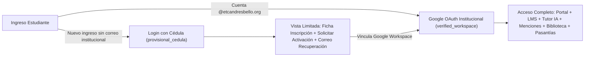
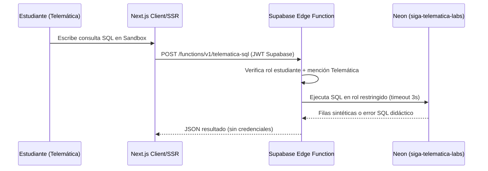

# 01 · Sección Alumnos — Documentación Completa de Módulos

**Perfil cubierto:** `estudiante` (en sus dos niveles de acceso: `provisional_cedula` para nuevo ingreso/onboarding y `verified_workspace` con cuenta institucional `@etcandresbello.org`).  
**Modelo de datos referenciado:** [00-MODELO-RELACIONAL-BD.md](./00-MODELO-RELACIONAL-BD.md).

---

## Arquitectura Transversal de Acceso Estudiantil

### Flujo de Ingreso (`provisional_cedula` → `@etcandresbello.org`)
- **¿Qué se quiere?** Garantizar que únicamente miembros reales de la E.T.C. "Andrés Bello" operen la plataforma completa con identidad institucional (`@etcandresbello.org`), rechazando `@gmail.com` o correos comerciales como login principal, pero permitiendo a alumnos recién inscritos (ej. 1.º año) entrar de forma limitada con su cédula mientras activan su cuenta Google Workspace.
- **¿Qué se va a hacer?**
  1. Un estudiante recién inscrito en Control de Estudios inicia sesión temporalmente con su **Cédula** (`access_tier = 'provisional_cedula'`).
  2. En este estado limitado solo puede visualizar su **ficha de inscripción**, el **instructivo de activación** de su cuenta `@etcandresbello.org`, registrar un **correo secundario de recuperación** (`recovery_email`) y enviar solicitud de activación.
  3. Una vez que vincula su Google OAuth `@etcandresbello.org` (verificado en callback de servidor `hd = etcandresbello.org`), el sistema eleva su cuenta a `verified_workspace` y desbloquea automáticamente el Portal completo, Aula Virtual, Tutor IA, Laboratorios por Mención, Biblioteca y Pasantías.
- **¿Cómo se puede construir?**
  - **Rutas:** `src/app/(auth)/login/`, `src/app/api/auth/callback/`.
  - **Seguridad en Servidor:** Validación estricta del dominio del correo en callback Supabase Auth (`email.endsWith('@etcandresbello.org')`); cualquier OAuth con otro dominio se rechaza antes de crear sesión en dashboard.
  - **BD / RLS:** Las políticas RLS de `virtual_courses`, `mention_lab_scenarios`, `library_loans` y `internship_placements` exigen `users.access_tier = 'verified_workspace'`.

---

## Módulo 1.1 · Portal del Estudiante, Simulador de Notas, Carnet QR y Trámites Express

### 1. ¿Qué se quiere?
Ofrecer al estudiante un punto único de autogestión académica para consultar su rendimiento oficial al instante, proyectar cuánto necesita para aprobar sus materias, identificarse mediante Carnet Digital seguro y solicitar constancias sin hacer colas presenciales en Secretaría.

### 2. ¿Qué se va a hacer?
- **Dashboard Estudiantil Gamificado:** Muestra horario escolar de la sección, calendario de evaluaciones programadas en los `evaluation_items`, progreso por Momento Pedagógico (1, 2 y 3), asistencia acumulada y medallas por desempeño o puntualidad.
- **Simulador *"¿Cuánto necesito para aprobar?"*:** Carga en tiempo real los ítems ponderados del plan de evaluación (`evaluation_items` + `student_scores`) y calcula matemáticamente la calificación mínima necesaria en las evaluaciones pendientes para alcanzar `>= 10` pts (o literal equivalente).
- **Carnet Digital Inteligente con QR:** Presenta foto optimizada `.webp`, nombre, cédula formateada (`V-12345678`), año, mención, sección y un código QR dinámico firmado criptográficamente con ventana temporal corta (donde cada token **se re-emite** rotando su firma e invalidando el anterior, nunca se renueva) para lectura en Biblioteca, portón o actos escolares.
- **Trámites y Solicitudes Express:** Formulario para solicitar constancia de estudio, constancia de inscripción, solvencia o revisión formal de calificación, con seguimiento de estado en tiempo real (`pending` → `in_review` → `approved` / `delivered`) y descarga directa del PDF oficial con QR.

### 3. ¿Cómo se puede construir?
- **Rutas y Componentes:**
  - `src/app/(dashboard)/estudiante/page.tsx` (Dashboard y Simulador).
  - `src/app/(dashboard)/estudiante/carnet/page.tsx` + `src/components/qr/` (`qrcode.react`).
  - `src/app/(dashboard)/estudiante/tramites/page.tsx` + `src/components/pdf/` (`@react-pdf/renderer`).
  - Lógica desacoplada en `src/features/control-estudios/` y `src/lib/validators/`.
- **Tablas y RPCs (`00-MODELO-RELACIONAL-BD.md`):**
  - Lectura bajo RLS de `enrollments`, `evaluation_plans`, `evaluation_items`, `student_scores`, `moment_final_grades`, `pending_subject_attempts` y `official_documents`.
  - Inserción validada con Zod en `student_requests` (bloqueo anti-doble envío con `useRef`).
  - RPC `siga_generar_token_carnet()`: firma JWT/HMAC de corta duración (`users.qr_token_secret`) en servidor sin exponer secretos al navegador.
- **Generación PDF Client-Side:** Cuando Secretaría aprueba un trámite y crea el registro en `official_documents`, el estudiante descarga el PDF renderizado en su navegador mediante `@react-pdf/renderer` (0 MB de carga en servidor) incrustando el `verification_code` apuntando a `/verificar`.

---

## Módulo 1.2 · Aula Virtual (LMS) y Tutor Socrático IA 24/7 (RAG)

### 1. ¿Qué se quiere?
Brindar un aula digital sincronizada automáticamente con la matrícula escolar donde el estudiante estudie con el material oficial de sus profesores, entregue actividades/evaluaciones y cuente con un Tutor IA disponible 24/7 que **guíe su razonamiento sin resolverle las tareas**.

### 2. ¿Qué se va a hacer?
- **Matriculación Automática:** Al quedar `active` en `enrollments`, las asignaturas de su sección aparecen automáticamente en su panel de cursos virtuales (`virtual_courses`), sin códigos de aula manuales ni riesgo de ingresar a secciones ajenas.
- **Módulos y Recursos Didácticos:** Descarga o vista previa de guías PDF, presentaciones, enlaces de video y fragmentos de código publicados por el docente.
- **Buzón de Tareas y Exámenes Online:** Envío de entregas digitales (texto o archivo comprimido/validado) con indicador claro de fecha límite o entrega tardía, y presentación de exámenes objetivos cronometrados con retroalimentación al cierre.
- **IA — Tutor Socrático 24/7 (RAG):** Chat contextual por asignatura que responde dudas exclusivamente a partir de las guías indexadas del docente en `pgvector`. Nunca entrega la respuesta final ni redacta ensayos completos; responde con pistas, ejemplos paralelos y preguntas paso a paso, mostrando citas de la guía consultada y recordando que la IA es orientativa y no sustituye la evaluación del docente.

### 3. ¿Cómo se puede construir?
- **Especificación unificada completa:** Ver [04-AULA-VIRTUAL.md](./04-AULA-VIRTUAL.md).
- **Rutas compartidas dentro de S.I.G.A.:** `src/app/(dashboard)/aula-virtual/page.tsx` (directorio único con todas las asignaturas de la sección inscrita, independientemente del año o mención) y `src/app/(dashboard)/aula-virtual/[courseId]/page.tsx` (sala de materia compartida con el docente). *No se construye como una aplicación externa ni subdominio independiente (`aula.*`).*
- **Capa Lógica e IA:** `src/features/aula-virtual/`, `src/lib/ai/`, `src/app/api/ai/tutor/route.ts` (o Supabase Edge Function dedicada) usando **Vercel AI SDK (`streamText`)** + **Gemini 2.5 Flash**.
- **Exámenes y Grounding RAG:**
  1. El alumno obtiene las preguntas mediante el RPC `public.siga_get_exam_questions_student(p_online_exam_id)` (sin exponer `correct_answer_json`) y envía respuestas vía `public.siga_submit_exam_attempt(p_online_exam_id, p_answers)`.
  2. Antes de consultar a Gemini para el Tutor IA, el backend valida que el `student_user_id` tenga `enrollment` activo en ese `virtual_course_id`.
  3. Calcula el embedding de la pregunta y ejecuta `public.siga_match_rag_chunks(p_virtual_course_id, ...)` sobre `rag_material_chunks` filtrada obligatoriamente por `virtual_course_id` (cero fuga entre asignaturas o menciones).
  4. Inyecta solo los fragmentos reales recuperados (`citations_json`) bajo *system prompt* socrático estricto y minimización de PII (no se envía cédula ni teléfono al LLM).
  5. Persiste la sesión en `ai_tutor_threads` y `ai_tutor_messages`. Si Gemini o la RPC fallan, muestra mensaje de error claro sin inventar respuestas.

---

## Módulo 1.3 · Entornos Prácticos Exclusivos por Mención Técnica (1.º a 6.º Año)

### 1. ¿Qué se quiere?
Proporcionar herramientas interactivas reales integradas **dentro del mismo Aula Virtual (`/aula-virtual`)** y alineadas con cada mención oficial de la E.T.C. "Andrés Bello" (*Telemática*, *Aduanas* y *Turismo*), de modo que la práctica técnica digital complemente las materias desde 1.º hasta 6.º año sin fragmentar el LMS principal ni crear nuevas tablas en la BD.

### 2. ¿Qué se va a hacer?
El sistema filtra automáticamente el entorno correspondiente a la `mencion_id` de la matrícula del alumno:

- **Mención Telemática (`/aula-virtual/telematica`):**
  1. *Sandbox de Práctica SQL y Código:* Editor interactivo donde el estudiante escribe consultas `SELECT` y ejercicios relacionales sobre tablas sintéticas en **Neon Serverless**, viendo resultados tabulares y mensajes reales de error PostgreSQL para aprender depuración.
  2. *Simulador de Redes, Subredes IP y T568A/B:* Calculadora práctica e interactiva de máscaras CIDR, capas OSI/TCP-IP y secuencia de colores de cableado estructurado.
  3. *Bitácora Técnica de Ensamblaje y Soporte TI:* Registro académico estructurado de prácticas de laboratorio (inventario de piezas, fallas simuladas/diagnosticadas e instalación de sistemas en el aula).
- **Mención Aduanas (`/aula-virtual/aduanas`):**
  1. *Clasificador Arancelario (Sistema Armonizado):* Buscador guiado de códigos arancelarios, notas de sección y ejercicio de clasificación de mercancías desde catálogo base y casos docentes.
  2. *Calculadora de Valoración CIF/FOB e Incoterms:* Simulador interactivo de desglose de valor FOB, flete, seguro, base imponible CIF y cálculo *ad valorem*.
  3. *Taller Documental de Comercio Exterior:* Formularios digitales modelo para diligenciar correctamente *Bill of Lading* (B/L), guías aéreas y declaraciones de aduana.
- **Mención Turismo (`/aula-virtual/turismo`):**
  1. *Planificador de Rutas Patrimoniales de Guayana:* Selección de puntos culturales, ecológicos e históricos (Ciudad Guayana, La Llovizna, Cachamay, Orinoco, Estado Bolívar) con cálculo de tiempos, guion interpretativo e itinerario.
  2. *Gestor de Eventos y Protocolo:* Plantillas académicas para organizar cronogramas, presupuestos de práctica y montaje protocolar.
  3. *Simulador de Recepción Hotelera y Guiones Bilingües:* Flujo interactivo de *check-in / check-out*, llenado de tarjetas de registro de huéspedes y diálogos de práctica español/inglés.

### 3. ¿Cómo se puede construir?
- **Rutas y Features:** `src/app/(dashboard)/aula-virtual/{telematica,aduanas,turismo}/`, `src/features/menciones/`, validadores Zod en `src/lib/validators/`.
- **Tablas y Aislamiento:**
  - `mention_lab_scenarios` (catálogo base + ejercicios asignados por docentes de esa mención) y `mention_lab_submissions` (`submission_payload` validado con Zod antes de guardar).
  - **Telemática SQL Sandbox:** El navegador envía la consulta a una **Supabase Edge Function**, la cual valida límites de longitud, conecta a **Neon (`siga-telematica-labs`)** usando un rol SQL de privilegios mínimos (`SELECT` / transacciones `ROLLBACK` + `statement_timeout = 3s`), registra la sesión en `lab_sandbox_sessions` usando `student_hash` (sin PII) y devuelve filas/errores. **Next.js nunca posee credenciales Neon.**

---

## Módulo 1.4 · Biblioteca Escolar (Vista Estudiante)

### 1. ¿Qué se quiere?
Permitir al estudiante consultar desde su teléfono o computadora si un libro técnico o proyecto socioproductivo está disponible en la Biblioteca Escolar, y controlar sus préstamos domiciliarios vinculados al Carnet Digital QR.

### 2. ¿Qué se va a hacer?
- Buscador en línea del catálogo de `library_items` filtrable por título, autor, tipo (`book`, `technical_manual`, `thesis_project`) y mención técnica, mostrando ejemplares disponibles en tiempo real.
- Visualización de préstamos activos (`library_loans`), fecha de vencimiento (`due_date`) e historial de devoluciones / solvencia bibliotecaria.
- Alertas automáticas in-app y por correo electrónico antes del vencimiento del préstamo.

### 3. ¿Cómo se puede construir?
- **Ruta:** `src/app/(dashboard)/biblioteca/page.tsx` (renderizado condicional de vista estudiante sin botones administrativos).
- **Datos y RLS:** Lectura abierta a `verified_workspace` sobre `library_items` y lectura restringida a `borrower_user_id = current_internal_user_id()` sobre `library_loans`. El préstamo físico se sella escaneando el Carnet QR del alumno y el QR del ejemplar desde el panel del bibliotecario.

---

## Módulo 1.5 · Portal del Pasante (6.º Año)

### 1. ¿Qué se quiere?
Guiar al estudiante de último año durante sus pasantías empresariales en Ciudad Guayana centralizando su bitácora semanal de horas y agilizando la revisión de redacción formal de su informe antes de entregarlo al tutor académico.

### 2. ¿Qué se va a hacer?
- Vista de su asignación (`internship_placements`): empresa receptora asignada, datos del tutor académico y del tutor empresarial, fechas de inicio/fin y estatus.
- Registro de la **Bitácora Semanal** (`internship_weekly_logs`): horas cumplidas y resumen de actividades por semana, con visualización de comentarios y aprobación del tutor académico.
- Carga de borradores del **Informe Final** (`internship_reports`) e invocación del **IA — Revisor Normativo**: analiza el texto para detectar redacción en primera persona (sugiriendo tercera persona), inconsistencias de tiempos verbales en pasado y ausencia de apartados reglamentarios antes de enviarlo oficialmente.

### 3. ¿Cómo se puede construir?
- **Rutas y Features:** `src/app/(dashboard)/pasantias/page.tsx`, `src/features/pasantias/`, `src/lib/storage/` (envío de PDF final aprobado hacia Storage / Google Drive API institucional vía servidor).
- **RLS:** El estudiante solo ve su propio `internship_placements` (habilitado solo si `enrollment.grade_year = 6` y `verified_workspace`).
- **IA Revisor Normativo:** Endpoint protegido que envía el texto extraído (desidentificado de datos sensibles innecesarios) a Gemini 2.5 Flash con salida estructurada Zod (`ai_normative_review` JSONB), persistiendo sugerencias reales sin modificar el archivo original del alumno.

---

## Módulo 1.6 · Bandeja de Notificaciones Internas (In-App + Correo)

### 1. ¿Qué se quiere?
Mantener informado al estudiante sobre eventos académicos y administrativos relevantes sin depender de Telegram ni notificaciones Push del navegador.

### 2. ¿Qué se va a hacer?
- Campana y bandeja de notificaciones en tiempo real dentro de S.I.G.A. (calificaciones publicadas, tareas próximas a vencer, estatus de constancias/trámites, vencimiento de libros en biblioteca, avances de pasantías y avisos de activación Workspace).
- Envío complementario por correo transaccional hacia el correo `@etcandresbello.org` (o `recovery_email` en avisos de onboarding/recuperación).

### 3. ¿Cómo se puede construir?
- **Componentes:** `src/components/shared/` (campana con suscripción única monotónica a Supabase Realtime en `notifications` filtrada por `recipient_user_id`).
- **Correo:** Trigger/RPC o Edge Function que despacha correo vía Mailtrap/Resend registrando trazabilidad en `notification_email_logs`.
