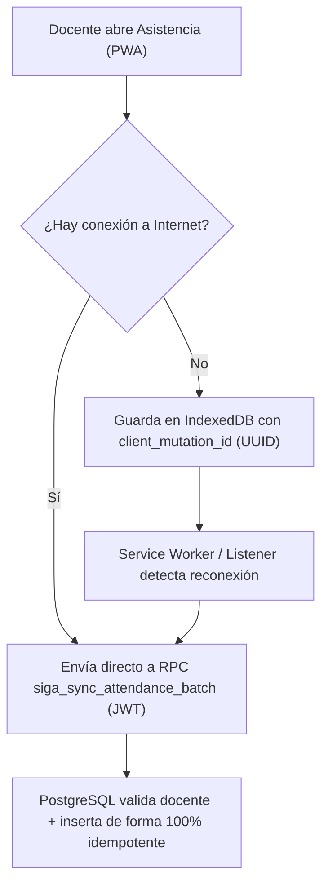

# 02 · Sección Docentes — Documentación Completa de Módulos

**Perfil cubierto:** `docente` (con soporte multi-rol en `user_roles` cuando el profesor ejerce simultáneamente funciones de `coordinador_mencion`, `coordinador_pasantias`, etc., ingresando exclusivamente mediante cuenta institucional `@etcandresbello.org`).  
**Modelo de datos referenciado:** [00-MODELO-RELACIONAL-BD.md](./00-MODELO-RELACIONAL-BD.md).

---

## Arquitectura Transversal de Acceso Docente

- Todo miembro del profesorado inicia sesión obligatoriamente con su cuenta Google Workspace **`@etcandresbello.org`** (`access_tier = 'verified_workspace'`).
- Todas sus vistas filtran dinámicamente por sus asignaciones reales en `teacher_assignments` para el `school_year_id` vigente, de modo que un profesor nunca puede leer ni editar calificaciones de secciones o asignaturas que no imparte.
- Si el docente posee más de un rol activo en `user_roles`, un selector limpio de contexto le permite alternar entre su panel de aula y sus módulos de coordinación sin requerir dos cuentas distintas.

---

## Módulo 2.1 · Planificación Académica Asistida por IA (MPPE)

### 1. ¿Qué se quiere?
Reducir el tiempo invertido por el docente en redactar planes de lapso, estrategias didácticas e indicadores de evaluación alineados con el MPPE, conectando esa planificación directamente con el cálculo real de notas del momento pedagógico.

### 2. ¿Qué se va a hacer?
- Al iniciar cada Momento Pedagógico (1, 2 o 3), el docente crea su **Plan de Evaluación Ponderado** (`evaluation_plans` + `evaluation_items`) para cada sección y asignatura asignada.
- Define las actividades evaluativas (pruebas en aula, entregas del Aula Virtual, exámenes online, prácticas de laboratorio por mención, proyectos) asignando pesos porcentuales cuya suma obligatoria es **`100 %`**.
- Puede activar el asistente de **Planificación Académica IA** para sugerir contenidos programáticos, estrategias metodológicas e indicadores evaluativos según año, mención (*Telemática*, *Aduanas*, *Turismo*) y asignatura, editando y aprobando la propuesta antes de publicarla para sus alumnos.

### 3. ¿Cómo se puede construir?
- **Rutas y Features:** `src/app/(dashboard)/docente/planificacion/page.tsx`, `src/features/control-estudios/`.
- **Tablas y Validación:** `evaluation_plans` y `evaluation_items`. Un RPC/validación Zod bloquea la publicación del plan si `SUM(weight_percent) != 100`.
- **IA:** Route Handler protegido con **Vercel AI SDK + Gemini 2.5 Flash** y salida estructurada Zod (`objectives`, `strategies`, `suggested_items`) sin almacenar datos personales de alumnos.

---

## Módulo 2.2 · Control de Aula: Asistencia *Offline-First*, Diario e Inasistencia Docente

### 1. ¿Qué se quiere?
Permitir que el profesor pase asistencia, registre incidencias de clase y notifique ausencias justificadas incluso en salones de Unare II donde falte temporalmente internet o fluido eléctrico, sin duplicar registros al sincronizar.

### 2. ¿Qué se va a hacer?
- **Pase de Asistencia *Offline-First* (PWA) y QR:**
  - Desde su celular o laptop, el docente marca asistencia (`present`, `absent`, `late`, `justified`) por lista de sección o escaneando con la cámara el **Carnet Digital QR** del estudiante al entrar al aula.
  - Si no hay conexión en el salón, los registros se encolan localmente con un UUID único por operación (`client_mutation_id`) y se sincronizan automáticamente en cuanto el dispositivo recupera señal.
- **Diario de Clases e Incidencias:** Registro breve del tema dictado en el bloque horario (`class_diary_entries`) y anotación de incidencias de convivencia o rezago, con opción de **derivar el caso directamente a Orientación** (`derive_to_orientation = true`) sin ver luego los apuntes confidenciales de Orientación.
- **Aviso de Inasistencia Docente:** Notificación formal anticipada (`teacher_absences`) indicando fecha, bloques horarios afectados y motivo para alertar automáticamente a Dirección y Coordinación de Mención y facilitar la reorganización del horario.

### 3. ¿Cómo se puede construir?
- **Rutas y Capa Offline:** `src/app/(dashboard)/docente/asistencia/page.tsx`, `src/features/asistencia/`, `src/lib/offline/` (**`@serwist/next` + `TanStack Query` + `IndexedDB`** via `idb-keyval`/`Dexie.js`), `src/components/qr/` (`html5-qrcode`).
- **Tablas y RPC Idempotente:**
  - `attendance_sessions`, `attendance_records` (restricción `UNIQUE (client_mutation_id)` + `ON CONFLICT DO NOTHING`), `class_diary_entries`, `teacher_absences`.
  - RPC `siga_sync_attendance_batch(...)` con validación previa de `siga_assert_teacher_subject_access(...)`.

---

## Módulo 2.3 · Aula Virtual (LMS), Carga Directa de Notas y Asistente Pedagógico IA

### 1. ¿Qué se quiere?
Centralizar la publicación de materiales y evaluaciones digitales, eliminar por completo la doble transcripción manual de notas (de aula virtual a planilla oficial) y ofrecer apoyo de IA para elaborar instrumentos evaluativos y detectar entregas duplicadas.

### 2. ¿Qué se va a hacer?
- **Publicación de Contenidos y Buzón:** El docente sube guías PDF, diapositivas, videos o código (`course_materials`); al subir una guía PDF, el sistema la indexa automáticamente en `pgvector` para alimentar al Tutor Socrático IA de esa única asignatura.
- **Motor de Evaluaciones Online con Sincronización Directa:** El docente crea exámenes objetivos (`online_exams`) vinculados a un ítem de su plan ponderado (`sync_to_evaluation_item_id`). Cuando el alumno finaliza el examen, la calificación se calcula automáticamente en servidor y se refleja directo en `student_scores` sin transcribir nada.
- **Planilla Oficial Ponderada y Escala MPPE (`1–20` / `A–E`):** En una misma matriz unificada, el profesor ve las notas sincronizadas desde el LMS junto con las actividades presenciales, registra calificaciones manuales dentro de la ventana abierta del momento (`momentos.status = 'open'`) y el sistema calcula el promedio ponderado redondeado oficial (`moment_final_grades`).
- **IA — Asistente Pedagógico Docente:**
  - *Generador de Exámenes y Rúbricas:* Genera borradores de preguntas (selección simple, múltiple, verdadero/falso) y criterios de rúbrica basándose en las guías PDF ya subidas por el docente.
  - *Pre-Evaluador de Entregas y Detector de Similitudes:* Analiza entregas de texto en `assignment_submissions` comparándolas contra la rúbrica y entre compañeros de la sección para alertar similitudes altas o posible plagio, dejando siempre la calificación definitiva en manos del profesor.

### 3. ¿Cómo se puede construir?
- **Rutas y Features:** `src/app/(dashboard)/aula-virtual/` (vista gestión docente), `src/app/(dashboard)/docente/notas/page.tsx`, `src/features/aula-virtual/`, `src/features/control-estudios/`.
- **Tablas y Seguridad RLS/RPC:**
  - `virtual_courses`, `course_modules`, `course_materials`, `rag_material_chunks` (índice HNSW `pgvector`), `assignments`, `assignment_submissions`, `online_exams`, `exam_questions` (`correct_answer_json` bloqueado por RLS a estudiantes mientras el examen esté activo), `student_scores`, `moment_final_grades`, `grade_audit_logs`.
  - RPC `siga_registrar_nota(...)` (`SECURITY DEFINER`, `SET search_path = public, pg_temp`): verifica asignación real del profesor al alumno/materia, verifica ventana abierta en `momentos` (o reapertura autorizada), registra en `grade_audit_logs` (inmutable) y recalcula `moment_final_grades`.

---

## Módulo 2.4 · Gestión de Entornos Prácticos por Mención (*Telemática*, *Aduanas*, *Turismo*)

### 1. ¿Qué se quiere?
Permitir al docente de especialidad publicar ejercicios prácticos reales sobre los simuladores de su mención, revisar las resoluciones enviadas por los alumnos y vincular sus notas directamente al plan de evaluación.

### 2. ¿Qué se va a hacer?
- Selecciona o duplica escenarios del catálogo base en `mention_lab_scenarios` según su mención (ej. un caso de valoración CIF/FOB en Aduanas, una consulta SQL sintética en Telemática o una ruta patrimonial/recepción en Turismo), ajusta instrucciones y fecha límite, y lo asocia a un `evaluation_item_id`.
- Revisa los `mention_lab_submissions` enviados (queries ejecutadas en Neon, cálculos CIF/FOB, bitácoras de soporte TI o guiones turísticos), coloca puntaje y retroalimentación directamente en la planilla.

### 3. ¿Cómo se puede construir?
- **Rutas:** `src/app/(dashboard)/aula-virtual/{telematica,aduanas,turismo}/gestion/` y `src/features/menciones/`.
- **BD:** Políticas RLS en `mention_lab_scenarios` que permiten crear/editar únicamente a docentes asignados a esa `mencion_id` y a su `coordinador_mencion`.

---

## Módulo 2.5 · Cierre de Momentos Pedagógicos y Generador IA de Observaciones Cualitativas

### 1. ¿Qué se quiere?
Agilizar el cierre de cada uno de los 3 Momentos Pedagógicos garantizando que los boletines cuenten con observaciones descriptivas personalizadas y basadas exclusivamente en datos reales del estudiante.

### 2. ¿Qué se va a hacer?
- Al completar todas las evaluaciones del lapso, el docente solicita sugerencias de **Observaciones Cualitativas IA** para su sección.
- El sistema consulta notas parciales reales, promedio acumulado, porcentaje de asistencia y entregas tardías del estudiante (sin inventar datos) y propone una redacción pedagógica respetuosa lista para que el docente la edite o apruebe (`moment_final_grades.qualitative_observation`).
- Al confirmar el cierre o vencer la fecha límite en `momentos`, las calificaciones quedan bloqueadas automáticamente.

### 3. ¿Cómo se puede construir?
- **Endpoint IA:** Route Handler protegido con **Vercel AI SDK + Gemini 2.5 Flash**, recibiendo métricas agregadas y primer nombre (minimizando cédula/datos personales innecesarios).
- **Auditoría:** Toda aprobación o modificación queda respaldada en `grade_audit_logs`.

---

## Módulo 2.6 · Tutoría Académica de Pasantías (6.º Año) y Reservas Audiovisuales

### 1. ¿Qué se quiere?
Facilitar al docente asignado como tutor académico de 6.º año el acompañamiento de sus pasantes y permitir a cualquier docente reservar equipos audiovisuales sin choques de horario.

### 2. ¿Qué se va a hacer?
- **Tutoría de Pasantías:** Visualiza únicamente los `internship_placements` donde figura como `academic_tutor_user_id`; revisa y aprueba semana a semana las bitácoras (`internship_weekly_logs`), consulta los hallazgos del Revisor Normativo IA sobre los borradores de informe (`internship_reports`) y carga la evaluación académica final.
- **Reserva de Equipos Audiovisuales:** Consulta disponibilidad en tiempo real de `audiovisual_resources` (videobeams, laptops, cornetas) y reserva fecha + bloque horario (`audiovisual_reservations`) recibiendo confirmación in-app y por correo desde Biblioteca.

### 3. ¿Cómo se puede construir?
- **Rutas:** `src/app/(dashboard)/pasantias/tutor/`, `src/app/(dashboard)/biblioteca/reservas/`.
- **Control de Concurrencia:** Las reservas de equipos audiovisuales pasan por un RPC con `pg_advisory_xact_lock(hashtext(resource_id::text || reserved_date::text))` (filtrando `deleted_at IS NULL`) para garantizar que dos profesores nunca puedan reservar el mismo videobeam en el mismo bloque horario.
