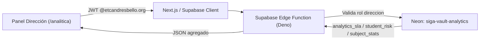
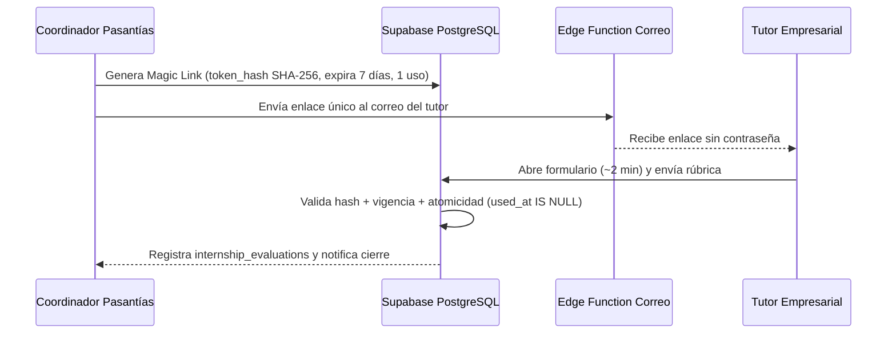

# 03 · Sección Administración y Coordinaciones — Documentación Completa de Módulos

**Perfiles cubiertos (tabla exclusiva `roles`):** `direccion`, `coordinador_mencion` (acotado por `mencion_id`), `control_estudios`, `orientacion`, `coordinador_pasantias` y `biblioteca`. Todo personal administrativo y coordinador accede únicamente con cuenta Google Workspace **`@etcandresbello.org`**.  
**Modelo de datos referenciado:** [00-MODELO-RELACIONAL-BD.md](./00-MODELO-RELACIONAL-BD.md).

---

## Módulo 3.1 · Dirección y Analítica Avanzada (BI sobre Neon vía Edge Functions)

### 1. ¿Qué se quiere?
Dar a la Dirección del plantel visibilidad en tiempo real sobre el desempeño académico y los cuellos de botella operativos de la escuela, sin ralentizar las operaciones diarias de secretaría y aulas en Supabase y generando los recaudos estadísticos oficiales exigidos por el CDCE y Zona Educativa.

### 2. ¿Qué se va a hacer?
- **Radar de Cuellos de Botella Operativos (SLA):**
  - *Semáforo de Carga Docente:* Mide el porcentaje de evaluaciones y notas cargadas por docente y sección antes de la fecha de cierre de cada momento pedagógico.
  - *Monitor de Tiempos de Secretaría:* Mide la duración promedio entre el ingreso de una `student_requests` y la emisión de su constancia o certificación en `official_documents`.
  - *Detector de Saturación en Inscripciones:* Identifica secciones con sobredemanda o retrasos en validación de recaudos durante el periodo de inscripción.
- **Auditoría de "Materias Filtro":** Ranking automatizado por mención, año y sección de las asignaturas con mayor tasa de reprobación o materias pendientes.
- **IA — Alerta Temprana de Deserción y Riesgo Académico:** Analiza tendencias de inasistencias, calificaciones `< 10` pts y atrasos en entregas para generar alertas proactivas en `analytics_student_risk`, permitiendo derivación temprana a Coordinación u Orientación.
- **Reportes Estadísticos Oficiales (CDCE / Zona Educativa):** Exportación de matrices oficiales de matrícula, prosecución, asistencia y rendimiento en **Excel / PDF** listos para entrega institucional.

### 3. ¿Cómo se puede construir?
- **Rutas y Features:** `src/app/(dashboard)/analitica/`, `src/features/analitica/`, `src/lib/neon/`.
- **Flujo Seguro Supabase → Edge Function → Neon (`siga-vault-analytics`):**
  1. Un *Cron Job* programado ejecuta una **Supabase Edge Function** que sincroniza por lotes las marcas de agua (`sync_watermarks`) hacia las tablas espejo de Neon y recalcula `analytics_subject_stats`, `analytics_sla_metrics` y `analytics_student_risk`.
  2. El navegador del Director consulta `/analitica`, que invoca una Edge Function autenticada (verificando rol `direccion` / permiso `analytics.view_institutional`) cacheada en cliente con **TanStack Query** (`staleTime` amplio) para consultar Neon sin exponer `NEON_VAULT_DATABASE_URL` en Next.js.

---

## Módulo 3.2 · Coordinación de Mención Técnica (*Telemática*, *Aduanas*, *Turismo*)

### 1. ¿Qué se quiere?
Permitir a cada Coordinador de Mención supervisar de 1.º a 6.º año el rendimiento académico, los entornos prácticos de su especialidad y la continuidad de clases de las secciones bajo su cargo, con acceso acotado estrictamente a su `mencion_id`.

### 2. ¿Qué se va a hacer?
- **Supervisión Académica por Mención:** Visualización de indicadores de asistencia, avance del Plan de Evaluación y notas de todas las secciones pertenecientes únicamente a su `mencion_id` (*Telemática*, *Aduanas* o *Turismo*), sin acceder a otras menciones ni a expedientes confidenciales de Orientación.
- **Gestión del Catálogo de Escenarios Prácticos:** Aprobación y estandarización de ejercicios base en `mention_lab_scenarios` para los docentes de su mención.
- **Atención de Incidencias y Reorganización ante Inasistencia Docente:** Recepción inmediata de alertas cuando un profesor registra un aviso en `teacher_absences` o reporta una incidencia académica en `class_diary_entries`, coordinando actividades o suplencias temporales en sus secciones.

### 3. ¿Cómo se puede construir?
- **Rutas:** `src/app/(dashboard)/docente/`, supervisión académica en `src/app/(dashboard)/aula-virtual/` (ver [04-AULA-VIRTUAL.md](./04-AULA-VIRTUAL.md)) y paneles filtrados en `src/app/(dashboard)/analitica/mencion/`.
- **RLS Acotado por `user_roles.mencion_id`:** Función SQL `siga_user_coord_mencion_id()` verifica que el usuario tenga rol `coordinador_mencion` activo y restringe sus consultas exclusivamente a `sections.mencion_id = user_roles.mencion_id`.

---

## Módulo 3.3 · Control de Estudios y Secretaría

### 1. ¿Qué se quiere?
Reemplazar por completo herramientas locales obsoletas (*Sisconot* y hojas aisladas) mediante un motor normativo MPPE auditable que gestione periodos, mallas, inscripciones asistidas por OCR, escala `1–20` / `A–E`, materias pendientes y emisión instantánea de documentos verificables por QR.

### 2. ¿Qué se va a hacer?
- **Configuración de Periodos y Mallas Curriculares:** Administración de `school_years`, apertura/cierre de los 3 `momentos`, creación de `sections`, malla `curriculum_subjects` (1.º a 6.º año por mención) y carga horaria `teacher_assignments`.
- **Inscripción, Prosecución Automática y Escáner OCR (~3s):**
  - Alta de nuevos ingresos, prosecución automática por lotes de estudiantes promovidos al año siguiente y gestión de equivalencias.
  - Digitalización de cédula, partida de nacimiento o boletín previo mediante **IA OCR**: extrae nombre, cédula normalizada (`V12345678`), fecha de nacimiento y notas previas en formato JSON estructurado para prellenar el formulario y reducir errores humanos.
  - Administración del acceso estudiantil: habilita acceso inicial `provisional_cedula` mientras el alumno activa su `@etcandresbello.org` y atiende solicitudes de activación.
- **Motor Normativo de Calificaciones MPPE y Materias Pendientes:**
  - Consolida notas en escala numérica `1–20` o literales `A–E` (`moment_final_grades`).
  - Administra **Materias Pendientes** (`pending_subject_attempts`) permitiendo hasta **4 momentos reglamentarios** por asignatura reprobada en paralelo con la inscripción del año cursado.
- **Cierre de Ventanas y Auditoría Inmutable:** Al vencer el periodo de carga, `momentos.status` cambia a `locked`; cualquier corrección excepcional exige autorización de Control de Estudios / Dirección quedando grabada para siempre en `grade_audit_logs` (quién, cuándo, valor anterior, valor nuevo y motivo, protegida contra `UPDATE`/`DELETE`).
- **Emisión PDF y Verificación Pública (`/verificar`):** Aprobación de `student_requests` y emisión masiva o individual de Boletines, Constancias y Certificaciones de Notas generando un registro en `official_documents` con `verification_code` + `document_hash`, descargado en navegador vía `@react-pdf/renderer` (0 MB servidor) y verificable públicamente por terceros (universidades o empresas) en `/verificar`.

### 3. ¿Cómo se puede construir?
- **Rutas y Features:** `src/app/(dashboard)/control-estudios/`, `src/app/verificar/`, `src/features/control-estudios/`, `src/components/pdf/`.
- **RPCs Críticos y Seguridad:**
  - `siga_inscribir_estudiante(...)`, `siga_prosecucion_anual(...)`, `siga_reabrir_momento_auditado(...)`, `siga_emitir_documento_oficial(...)` todos `SECURITY DEFINER SET search_path = public, pg_temp` con registro obligatorio en `grade_audit_logs`.
  - **Superficie Pública `/verificar`:** Único RPC público (`siga_public_verificar_documento(p_code)` otorgado a `anon`) con rate-limit en servidor y retorno estricto de datos no sensibles (estatus válido/revocado, tipo de documento, fecha de emisión, nombre parcial/verificado e institución), **nunca** teléfonos, direcciones ni historial clínico/orientación.
- **IA OCR:** Route Handler protegido con **Vercel AI SDK + Gemini 2.5 Flash** (visión multimodal) validando la salida con esquema **Zod**; si falla o la imagen es ilegible, devuelve error claro sin rellenar valores inventados.

---

## Módulo 3.4 · Orientación y Psicopedagogía (Confidencialidad Reforzada K12)

### 1. ¿Qué se quiere?
Proveer al departamento de Orientación un expediente confidencial seguro integrado con los casos derivados desde aula o dirección, protegiendo estrictamente la privacidad socioemocional y familiar del menor frente a usuarios no autorizados.

### 2. ¿Qué se va a hacer?
- Recepción de derivaciones marcadas por docentes en `class_diary_entries` (`derive_to_orientation = true`) o alertas tempranas de riesgo (`analytics_student_risk`).
- Creación y actualización de **Expedientes Confidenciales** (`orientation_records` y `orientation_followups`): actas de compromiso, acuerdos de convivencia escolar, factores de vulnerabilidad socioeconómica y notas de evolución psicopedagógica.
- Emisión de citaciones internas estudiantiles cuando corresponde, sin exponer las notas confidenciales del caso.

### 3. ¿Cómo se puede construir?
- **Rutas y Features:** `src/app/(dashboard)/control-estudios/orientacion/`, `src/features/orientacion/`.
- **Blindaje Máximo de Datos:**
  - Políticas RLS estrictas: solo `orientacion` y `direccion` tienen permiso `SELECT`/`INSERT`/`UPDATE`. Ningún docente, coordinador de mención, bibliotecario o alumno puede ver siquiera la existencia del registro.
  - **Cero Supabase Realtime:** Estas tablas jamás se agregan a `supabase_realtime` ni se replican en claro a cachés compartidos o analítica pública.

---

## Módulo 3.5 · Coordinación de Pasantías y Servicio Comunitario (6.º Año)

### 1. ¿Qué se quiere?
Digitalizar de principio a fin la vinculación entre los estudiantes de 6.º año y las empresas receptoras de Ciudad Guayana, automatizar el emparejamiento estudiante-empresa y recoger la evaluación del tutor empresarial en menos de 2 minutos sin obligarlo a registrarse.

### 2. ¿Qué se va a hacer?
- **CRM de Empresas Receptoras:** Registro y actualización de empresas aliadas de Ciudad Guayana (`internship_companies`) por sector (*Telemática*, *Aduanas*, *Turismo*, *Administración*), zona de Puerto Ordaz, contactos y cupos disponibles.
- **IA — Matchmaking de Ubicación:** Cruza la mención del pasante, su zona de residencia en Puerto Ordaz, promedio académico y competencias técnicas para sugerir las empresas compatibles con mayor puntaje (`ai_match_score`).
- **Documentación Masiva en 1 Clic:** Emisión por lotes de Cartas de Postulación, Cartas de Aceptación y Actas de Compromiso registradas en `official_documents` con código QR verificable en `/verificar`.
- **Asignación de Tutor Académico y Cierre:** Vincula al docente supervisor (`academic_tutor_user_id`), monitorea bitácoras semanales e informes revisados por IA, y genera un **Magic Link** (`internship_magic_links`) de un solo uso y expiración controlada para que el tutor empresarial complete la rúbrica (`internship_evaluations`) desde su celular u oficina sin contraseña.

### 3. ¿Cómo se puede construir?
- **Rutas y Features:** `src/app/(dashboard)/pasantias/coordinacion/`, `src/app/(auth)/evaluar-pasantia/[token]/` (o ruta pública acotada para Magic Link), `src/features/pasantias/`.
- **Seguridad del Magic Link:** El token viaja en URL; en BD solo se almacena su hash SHA-256 (`token_hash`) con `expires_at` y `max_uses = 1`. Al enviarse `internship_evaluations`, el RPC marca `used_at = now()`, guarda la evaluación con firma transaccional y notifica in-app + correo al coordinador y tutor académico.

---

## Módulo 3.6 · Administración de Biblioteca Escolar y Equipos Audiovisuales

### 1. ¿Qué se quiere?
Controlar con precisión el inventario de libros físicos, trabajos de grado y equipos audiovisuales del plantel mediante códigos QR, eliminando pérdidas de activos y automatizando la emisión de solvencias bibliotecarias.

### 2. ¿Qué se va a hacer?
- **Inventario Bibliográfico con Etiquetado QR:** Alta, edición y etiquetado imprimible QR por ejemplar (`library_items`), optimizando portadas a `.webp`.
- **Control de Préstamos y Solvencias:** El bibliotecario escanea el Carnet QR del estudiante y el QR del libro para registrar la salida (`library_loans`), controlar devoluciones/vencimientos (avisando por bandeja in-app y correo) y emitir solvencias requeridas por Control de Estudios.
- **Administración de Equipos Audiovisuales:** Gestión del catálogo (`audiovisual_resources`) y entrega/recepción de videobeams, laptops y sonido reservados por docentes (`audiovisual_reservations`).

### 3. ¿Cómo se puede construir?
- **Rutas y Features:** `src/app/(dashboard)/biblioteca/admin/`, `src/features/biblioteca/`, `src/components/qr/` (`html5-qrcode` + `qrcode.react`), `src/lib/storage/` (`browser-image-compression`).
- **Concurrencia:** Los préstamos y reservas usan transacciones/RPC con `pg_advisory_xact_lock` y decremento atómico de `available_copies` verificando `available_copies > 0`.

---

## Módulo 3.7 · Administración de Roles (`roles`), Auditoría y Respaldo Activo

### 1. ¿Qué se quiere?
Permitir a Dirección asignar múltiples roles institucionales desde una interfaz segura sin editar código ni tablas de base de datos, y garantizar respaldo activo constante en Neon.

### 2. ¿Qué se va a hacer?
- **Gestión Multi-Rol (`user_roles`):** Dirección selecciona un miembro del personal verificado con `@etcandresbello.org` y activa o revoca sus roles desde el catálogo exclusivo `roles` (por ejemplo, asignar `coordinador_mencion` + `mencion_id` a un `docente`, o asignarle temporalmente `coordinador_pasantias` con fecha `valid_until`).
- **Panel de Auditoría e Integridad del Respaldo:** Consulta de `grade_audit_logs` (solo lectura inmutable) y verificación del estado de sincronización incremental hacia Neon (`sync_watermarks` y `moment_snapshots` al cierre de cada momento).

### 3. ¿Cómo se puede construir?
- **Seguridad RBAC:** Únicamente el rol `direccion` (permiso `rbac.assign_roles`) puede ejecutar el RPC `siga_gestionar_user_role(...)`, el cual impide auto-revocarse el último rol `direccion` activo del plantel y deja traza auditada.
- **Respaldo Activo:** Ejecutado por **Supabase Edge Functions** hacia **Neon (`siga-vault-analytics`)** manteniendo cero credenciales de Neon en Next.js.
