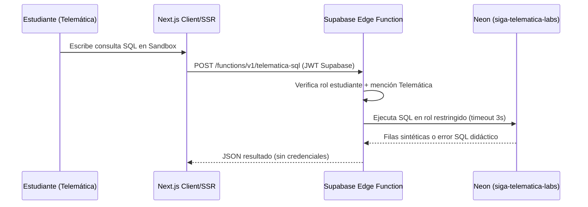
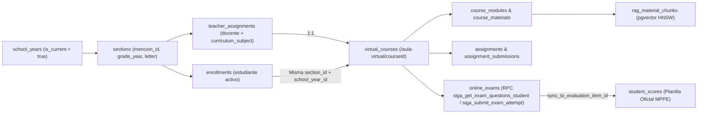

# 04 · Aula Virtual Unificada (LMS Integrado) — S.I.G.A.

**Decisión arquitectónica aprobada:** El Aula Virtual de la **E.T.C. "Andrés Bello"** se implementa como **un único módulo unificado dentro de S.I.G.A.** bajo la ruta `/aula-virtual` (sin aplicación separada ni subdominio externo independiente como `aula.etcandresbello.org`), compartiendo la misma sesión autenticada, el sistema visual Glassmorphism (`DashboardShell` + *Curved Sidebar*), la base de datos Supabase PostgreSQL y el motor oficial de calificaciones MPPE.

**Modelo de datos referenciado:** [00-MODELO-RELACIONAL-BD.md](./00-MODELO-RELACIONAL-BD.md) · **Vistas relacionadas:** [01-ALUMNOS.md](./01-ALUMNOS.md) · [02-DOCENTES.md](./02-DOCENTES.md).

---

## 1. Principios de Diseño del Aula Virtual Única

1. **Un solo campus digital para todo el plantel (1.º a 6.º año):**
   - Todos los **estudiantes** y todos los **docentes** de las tres menciones (*Telemática*, *Aduanas* y *Turismo*) confluyen en **`/aula-virtual`** sobre todas sus materias (formación general y áreas técnicas), sin fragmentar las asignaturas en portales separados por mención ni duplicar interfaces.
2. **Inscripción automática desde matrícula y carga horaria real:**
   - Un estudiante nunca busca ni introduce "códigos de clase". Al existir su registro activo en `enrollments`, ve automáticamente las materias de su sección y año cuyos cursos hayan sido publicados por sus profesores (`virtual_courses.is_published = true`).
   - Un docente ve únicamente los cursos de las secciones y materias que tiene asignadas en `teacher_assignments` para el `school_year_id` vigente.
3. **Misma ruta `/aula-virtual/[courseId]`, experiencia adaptada por rol bajo RLS:**
   - **Estudiante (`verified_workspace`):** visualiza módulos visibles, descarga guías, entrega tareas, presenta exámenes cronometrados y consulta al Tutor Socrático IA de esa materia. *(Cuentas en estado `provisional_cedula` tienen bloqueado el LMS por RLS hasta vincular su correo `@etcandresbello.org`).*
   - **Docente titular (`teaches_assignment`):** dentro del mismo curso administra módulos (`course_modules`), materiales (`course_materials`), tareas (`assignments`), exámenes (`online_exams`), rúbricas, revisión de entregas (`assignment_submissions`) y calificación directa hacia `student_scores`.
   - **Coordinación de Mención / Dirección:** supervisión de lectura acotada (`is_coord_of_mencion(s.mencion_id)` o `direccion`).
4. **Los laboratorios por mención viven *dentro* del Aula Virtual unificada:**
  - `/aula-virtual/telematica`, `/aula-virtual/aduanas` y `/aula-virtual/turismo` no reemplazan a `/aula-virtual`; son **entornos prácticos complementarios** (`mention_lab_scenarios` y `mention_lab_submissions`) enlazados desde el propio campus para prácticas técnicas de especialidad.

---

## 1B. Alcance Funcional: LMS, Tutor Socrático IA 24/7 y Entornos Prácticos por Mención

### Aula Virtual (LMS) y Tutor Socrático IA 24/7 (RAG)
- **Matriculación Automática:** Al quedar `active` en `enrollments`, las áreas de formación de su sección aparecen automáticamente en su panel de cursos virtuales (`virtual_courses`), sin códigos de aula manuales ni riesgo de ingresar a secciones ajenas.
- **Módulos y Recursos Didácticos:** Descarga o vista previa de guías PDF, presentaciones, enlaces de video y fragmentos de código publicados por el docente.
- **Buzón de Tareas y Exámenes Online:** Envío de entregas digitales (texto o archivo validado) con indicador claro de fecha límite o entrega tardía, y presentación de exámenes objetivos cronometrados (`siga_get_exam_questions_student` / `siga_submit_exam_attempt`) con sincronización directa a `student_scores`.
- **Tutor Socrático IA 24/7 (RAG):** Chat contextual por área de formación que responde dudas exclusivamente a partir de las guías indexadas del docente en `pgvector` (`siga_match_rag_chunks` filtrado por `virtual_course_id`). Nunca entrega la respuesta final ni redacta ensayos completos; guía paso a paso con pistas, ejemplos paralelos y citas de la guía consultada, persistiendo sesiones en `ai_tutor_threads` y `ai_tutor_messages`.

### Entornos Prácticos Exclusivos por Mención Técnica (1.º a 6.º Año)
El campus filtra automáticamente el entorno correspondiente a la `mencion_id` de la matrícula del alumno:

- **Mención Telemática — Especialidad Industrial (`/aula-virtual/telematica`):**
  1. *Sandbox de Práctica SQL y Código:* Editor interactivo donde el estudiante ejecuta consultas `SELECT` y ejercicios relacionales sobre tablas sintéticas en **Neon Serverless (`siga-telematica-labs`)** vía Edge Function con rol de privilegios mínimos y `statement_timeout = 3s`, viendo resultados tabulares y errores SQL reales para aprender depuración.
  2. *Simulador de Redes, Subredes IP y T568A/B:* Calculadora interactiva de máscaras CIDR, capas OSI/TCP-IP y secuencia de colores de cableado estructurado.
  3. *Bitácora Técnica de Ensamblaje y Soporte TI:* Registro académico estructurado de prácticas de laboratorio (inventario de piezas, fallas diagnosticadas e instalación de sistemas).
- **Mención Aduana — Especialidad Economía Social (`/aula-virtual/aduanas`):**
  1. *Clasificador Arancelario (Sistema Armonizado):* Buscador guiado de códigos arancelarios, notas de sección y ejercicio de clasificación de mercancías desde catálogo base y casos docentes.
  2. *Calculadora de Valoración CIF/FOB e Incoterms:* Simulador interactivo de desglose de valor FOB, flete, seguro, base imponible CIF y cálculo *ad valorem*.
  3. *Taller Documental de Comercio Exterior:* Formularios digitales modelo para diligenciar correctamente *Bill of Lading* (B/L), guías aéreas y declaraciones de aduana.
- **Mención Turismo — Especialidad Economía Social (`/aula-virtual/turismo`):**
  1. *Planificador de Rutas Patrimoniales de Guayana:* Selección de puntos culturales, ecológicos e históricos (Ciudad Guayana, La Llovizna, Cachamay, Orinoco, Estado Bolívar) con cálculo de tiempos, guion interpretativo e itinerario.
  2. *Gestor de Eventos y Protocolo:* Plantillas académicas para organizar cronogramas, presupuestos de práctica y montaje protocolar.
  3. *Simulador de Recepción Hotelera y Guiones Bilingües:* Flujo interactivo de *check-in / check-out*, tarjetas de registro de huéspedes y diálogos de práctica español/inglés.



---

## 2. Arquitectura de Rutas y Módulos en Next.js App Router

```text
src/
├── app/(dashboard)/aula-virtual/
│   ├── page.tsx                  # Campus único: directorio de cursos del estudiante o docente
│   ├── [courseId]/
│   │   └── page.tsx              # Sala compartida de asignatura (Módulos, Tareas, Exámenes, Tutor IA)
│   ├── telematica/page.tsx       # Laboratorio práctico Telemática (SQL Neon Sandbox, Redes IP, Bitácora TI)
│   ├── aduanas/page.tsx          # Laboratorio práctico Aduanas (Arancel, CIF/FOB, Documentos B/L)
│   └── turismo/page.tsx          # Laboratorio práctico Turismo (Rutas Guayana, Eventos, Recepción)
├── app/api/ai/
│   ├── tutor/route.ts            # Streaming RAG Tutor Socrático (Vercel AI SDK + Gemini 2.5 Flash)
│   └── lms-assistant/route.ts    # Asistente docente (bancos de preguntas, rúbricas, similitud)
└── features/aula-virtual/        # Queries SSR bajo RLS, acciones de servidor y esquemas Zod
```

> **Integración futura en navegación:** Cuando los módulos estén listos, agregar el acceso `Aula Virtual` (`/aula-virtual`) en [DashboardSidebar.tsx](../../src/components/dashboard/DashboardSidebar.tsx) para los roles `estudiante`, `docente`, `coordinador_mencion` y `direccion`.

---

## 3. Flujo Relacional en Supabase (`00001_initial_baseline.sql`)



### Tablas y RPCs ya disponibles en el Baseline SQL

- **Tablas núcleo del LMS:** `virtual_courses`, `course_modules`, `course_materials`, `rag_material_chunks`, `assignments`, `assignment_submissions`, `online_exams`, `exam_questions`, `exam_attempts`, `ai_tutor_threads`, `ai_tutor_messages`.
- **Tablas de laboratorios técnicos:** `mention_lab_scenarios`, `mention_lab_submissions`.
- **RPCs `SECURITY DEFINER` listos para invocar desde cliente/servidor autenticado:**
  1. `public.siga_get_exam_questions_student(p_online_exam_id UUID)`: valida cuenta `verified_workspace`, curso publicado, ventana horaria (`opens_at..closes_at`) y matrícula del alumno antes de devolver preguntas **sin `correct_answer_json`**.
  2. `public.siga_submit_exam_attempt(p_online_exam_id UUID, p_answers JSONB)`: calcula la calificación en servidor, valida `max_attempts`, inserta en `exam_attempts` y, si `sync_to_evaluation_item_id IS NOT NULL`, sincroniza la nota directo a `student_scores` (`source = 'lms_exam_sync'`).
  3. `public.siga_match_rag_chunks(p_virtual_course_id UUID, p_query_embedding vector(768), p_match_count INT)`: valida pertenencia al curso y retorna únicamente fragmentos vectoriales de ese `virtual_course_id`.
  4. `public.siga_registrar_nota(...)`: calificación docente manual de entregas o laboratorios vinculada al plan ponderado oficial.

---

## 4. Guía de Implementación Segura para el Equipo

### 4.1 Consulta por rol en `/aula-virtual` (`page.tsx`)
1. Resolver perfil autenticado en servidor mediante `getAuthenticatedDashboardContext()` (el cual ya valida sesión y rol bajo RLS).
2. Usar `createServerSupabaseClient()` (con RLS activo; nunca exponer `service_role` ni llaves de IA en cliente):
   - **Si `primaryRole === 'estudiante'`:** consultar `enrollments` vigente (`school_years.is_current = true`), cruzar `teacher_assignments` de su `section_id` y cargar los `virtual_courses` (`is_published = true`) junto al nombre del docente y asignatura. Si `accessTier === 'provisional_cedula'`, mostrar aviso claro invitando a vincular Google Workspace `@etcandresbello.org`.
   - **Si `primaryRole` es `'docente'` o `'coordinador_mencion'`:** consultar `teacher_assignments` donde `teacher_user_id = profile.internalUserId` y su relación `virtual_courses` (permitiendo crear/inicializar el `virtual_course` de una sección asignada si aún no existe).
3. Mostrar estados vacíos honestos si aún no hay materias publicadas (prohibido simular cursos o notas de relleno).

### 4.2 Verificación de pertenencia en rutas hijas y aislamiento RLS
- `pol_virtual_courses_select` restringe estrictamente la fila de `virtual_courses` a los docentes titulares, coordinación de la mención, Control de Estudios/Dirección y alumnos matriculados en esa `section_id`.
- En las tablas dependientes (`course_modules`, `course_materials`, `assignments`, `online_exams`), sus políticas base verifican `is_verified_workspace()`, por lo que **toda consulta en Next.js debe validar primero acceso al `virtual_course_id` padre y filtrar explícitamente por `.eq("virtual_course_id", courseId)`** (o considerar endurecer dichas políticas hijo con un `JOIN` a `enrollments`/`teacher_assignments` en una nueva migración de BD antes de abrir a producción).
- Nunca consultar directamente `exam_questions` desde el navegador de un estudiante; usar siempre `siga_get_exam_questions_student` y `siga_submit_exam_attempt`.

### 4.3 Tutor Socrático IA y Asistente Docente
- Usar **Vercel AI SDK** (`streamText`) + **Gemini 2.5 Flash** exclusivamente en Route Handlers de servidor (`/api/ai/*`) o Supabase Edge Functions.
- Minimizar PII: jamás enviar cédula, correo o teléfono del estudiante en el prompt; enviar solo `firstName`, curso y fragmentos reales recuperados vía `siga_match_rag_chunks`.
- Si no existen guías indexadas (`rag_status = 'indexed'`) o falla la API del modelo, mostrar un aviso honesto al usuario en lugar de generar respuestas fuera del contexto de la materia.

---

## 5. División Recomendada para Trabajo en Paralelo (Equipo de 3)

| Responsable sugerido | Entregables principales sobre `/aula-virtual` |
| :--- | :--- |
| **Base compartida (`/aula-virtual`)** | `page.tsx` (listado por rol alumno/docente), `features/aula-virtual/queries.ts`, tarjetas Glassmorphism de cursos y componente de laboratorio por mención. |
| **Flujo Estudiante** | Vista de módulos/guías en `[courseId]`, buzón de entregas (`assignment_submissions` con lock `useRef` anti-doble envío), reproductor de exámenes vía RPC y chat del Tutor Socrático RAG. |
| **Flujo Docente** | Creación/publicación de `virtual_courses`, CRUD de módulos/materiales, constructor de exámenes vinculado a `evaluation_items`, pre-evaluación IA de entregas y calificación directa a `student_scores`. |
